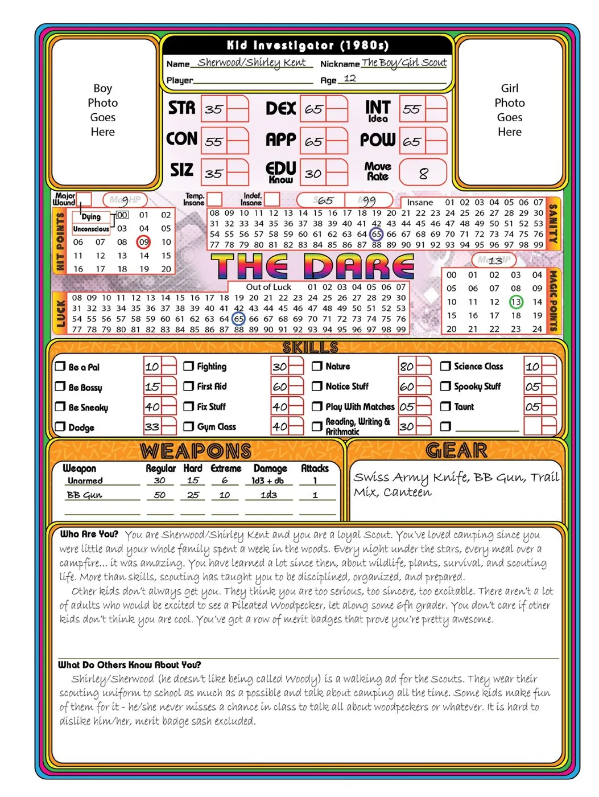

## Шервуд/Ширли Кент — «Скаут»

**Юный сыщик (1980-е)**

| Имя | Прозвище | Игрок | Возраст |
|---|---|---|---|
| Шервуд/Ширли Кент | Скаут | — | 12 |

| СИЛ | ВЫН | ТЕЛ | ЛВК | НАР | ОБР (Знание) | ИНТ (Идея) | МОЩ | Скорость |
|---|---|---|---|---|---|---|---|---|
| 35 | 55 | 35 | 65 | 65 | 30 | 55 | 65 | 8 |

**ПЗ** 9 · **ПМ** 13 · **Удача** 65 · **Рассудок** 65 (макс. 99)

*На листе — шкалы ПЗ, Рассудка, Удачи и ПМ с клетками для отметок «Серьёзная рана», «При смерти», «Без сознания», «Временное безумие», «Бессрочное безумие»; в углах — рамки «Фото мальчика» и «Фото девочки» для своего портрета.*

**Навыки**

| Навык | % | Навык | % | Навык | % | Навык | % |
|---|---|---|---|---|---|---|---|
| Быть другом | 10 | Драка | 30 | Природа | 80 | Школьные науки | 10 |
| Командовать | 15 | Первая помощь | 60 | Замечать всякое | 60 | Жуткие штуки | 05 |
| Красться | 40 | Чинить вещи | 40 | Играть со спичками | 05 | Дразнить | 05 |
| Уклонение | 33 | Физкультура | 40 | Чтение, письмо и счёт | 30 | — |  |

**Оружие**

| Оружие | Обычный | Трудный | Чрезвычайный | Урон | Атак |
|---|---|---|---|---|---|
| Без оружия | 30 | 15 | 6 | 1d3 + БкУ | 1 |
| Пневматическая винтовка | 50 | 25 | 10 | 1d3 | 1 |

**Снаряжение:** Швейцарский армейский нож, пневматическая винтовка, походная смесь орехов и сухофруктов, фляга.

### Кто ты?

Ты — Шервуд / Ширли Кент, верный скаут. Ты любишь походы с тех пор, как маленьким(ой) провёл(а) с семьёй неделю в лесу: каждая ночь под звёздами, каждая еда у костра… это было потрясающе. С тех пор ты много узнал(а) о диких животных, растениях, выживании и скаутской жизни. Но важнее навыков то, что скаутство научило тебя дисциплине, собранности и готовности ко всему.

Другие дети не всегда тебя понимают: им кажется, что ты слишком серьёзный(ая), слишком искренний(яя), слишком легко загораешься. Не так уж много взрослых обрадуется желне, не то что шестиклассник. А тебе всё равно, считают тебя крутым(ой) или нет: у тебя целый ряд значков за заслуги, которые доказывают, что ты вполне себе молодец.

### Что о тебе знают другие?

Ширли/Шервуд (он не любит, когда его зовут Вуди) — ходячая реклама скаутов: носит скаутскую форму в школу при любой возможности и всё время говорит о походах. Некоторые дети над этим смеются — он(а) не упускает случая рассказать на уроке всё о дятлах или о чём-нибудь таком. Но не любить его(её) трудно — разве что за ленту со значками.
