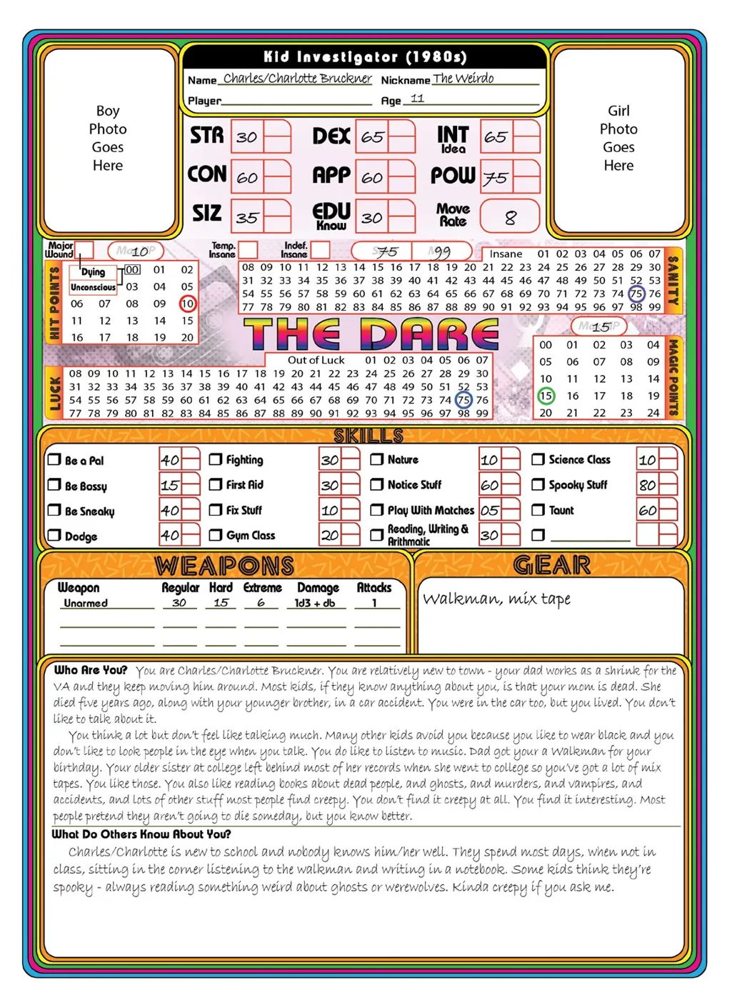

## Чарльз/Шарлотта Брукнер — «Чудик»

**Юный сыщик (1980-е)**

| Имя | Прозвище | Игрок | Возраст |
|---|---|---|---|
| Чарльз/Шарлотта Брукнер | Чудик | — | 11 |

| СИЛ | ВЫН | ТЕЛ | ЛВК | НАР | ОБР (Знание) | ИНТ (Идея) | МОЩ | Скорость |
|---|---|---|---|---|---|---|---|---|
| 30 | 60 | 35 | 65 | 60 | 30 | 65 | 75 | 8 |

**ПЗ** 10 · **ПМ** 15 · **Удача** 75 · **Рассудок** 75 (макс. 99)

*На листе — шкалы ПЗ, Рассудка, Удачи и ПМ с клетками для отметок «Серьёзная рана», «При смерти», «Без сознания», «Временное безумие», «Бессрочное безумие»; в углах — рамки «Фото мальчика» и «Фото девочки» для своего портрета.*

**Навыки**

| Навык | % | Навык | % | Навык | % | Навык | % |
|---|---|---|---|---|---|---|---|
| Быть другом | 40 | Драка | 30 | Природа | 10 | Школьные науки | 10 |
| Командовать | 15 | Первая помощь | 30 | Замечать всякое | 60 | Жуткие штуки | 80 |
| Красться | 40 | Чинить вещи | 10 | Играть со спичками | 05 | Дразнить | 60 |
| Уклонение | 40 | Физкультура | 20 | Чтение, письмо и счёт | 30 | — |  |

**Оружие**

| Оружие | Обычный | Трудный | Чрезвычайный | Урон | Атак |
|---|---|---|---|---|---|
| Без оружия | 30 | 15 | 6 | 1d3 + БкУ | 1 |

**Снаряжение:** Плеер «Уокмен», кассета со сборником.

### Кто ты?

Ты — Чарльз / Шарлотта Брукнер. Ты в городе недавно: папа работает психиатром в Управлении по делам ветеранов, и его всё время переводят с места на место. Большинство детей, если что-то о тебе и знают, то лишь то, что твоя мама умерла. Пять лет назад она погибла в автокатастрофе вместе с твоим младшим братом. Ты тоже был(а) в машине, но выжил(а). Говорить об этом ты не любишь.

Ты много думаешь, но говорить не хочется. Многие дети тебя сторонятся: ты любишь носить чёрное и не смотришь людям в глаза, когда говоришь. Зато ты любишь слушать музыку: на день рождения папа подарил тебе «Уокмен». Старшая сестра, уезжая в колледж, оставила почти все свои пластинки, так что у тебя куча кассет со сборниками. Они тебе нравятся. Ещё ты любишь читать книги о мертвецах, привидениях, убийствах, вампирах, несчастных случаях и прочем, что большинство людей считает жутким. Тебе не жутко — тебе интересно. Большинство людей делает вид, что однажды не умрёт, а ты знаешь лучше.

### Что о тебе знают другие?

Чарльз/Шарлотта в школе новенький(ая), и толком его(её) никто не знает. Почти всё время вне уроков сидит в углу, слушает плеер и что-то пишет в тетрадь. Некоторые считают его(её) жутковатым(ой) — вечно читает что-то странное про призраков или оборотней. Как по мне, так стрёмно.
