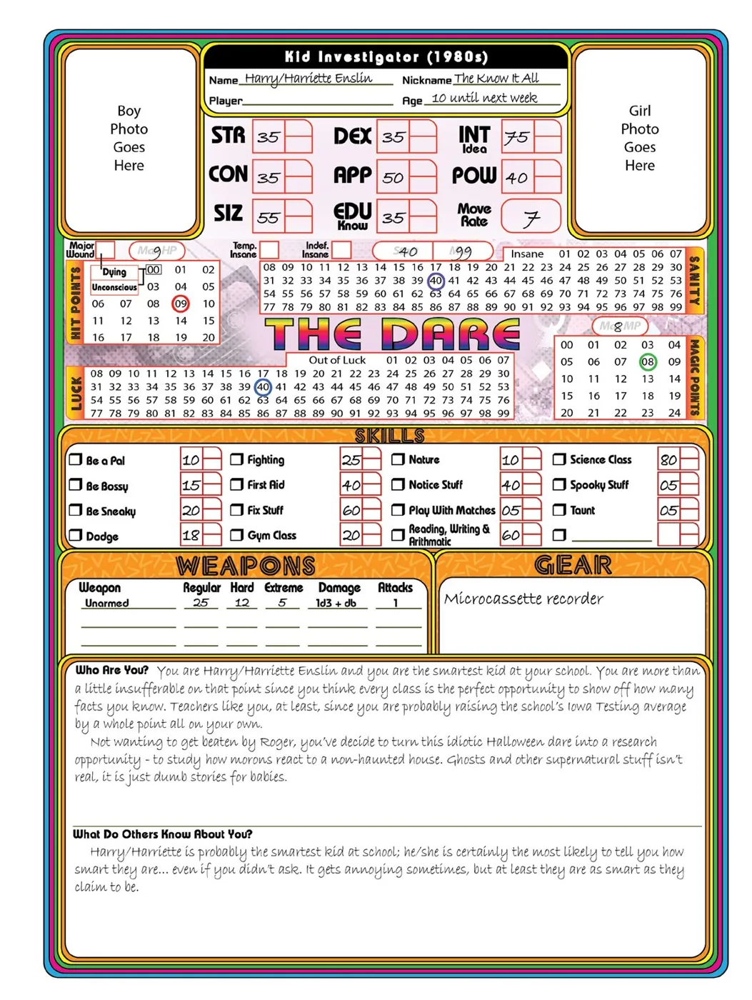

## Гарри/Гарриет Энслин — «Всезнайка»

**Юный сыщик (1980-е)**

| Имя | Прозвище | Игрок | Возраст |
|---|---|---|---|
| Гарри/Гарриет Энслин | Всезнайка | — | 10, через неделю будет 11 |

| СИЛ | ВЫН | ТЕЛ | ЛВК | НАР | ОБР (Знание) | ИНТ (Идея) | МОЩ | Скорость |
|---|---|---|---|---|---|---|---|---|
| 35 | 35 | 55 | 35 | 50 | 35 | 75 | 40 | 7 |

**ПЗ** 9 · **ПМ** 8 · **Удача** 40 · **Рассудок** 40 (макс. 99)

*На листе — шкалы ПЗ, Рассудка, Удачи и ПМ с клетками для отметок «Серьёзная рана», «При смерти», «Без сознания», «Временное безумие», «Бессрочное безумие»; в углах — рамки «Фото мальчика» и «Фото девочки» для своего портрета.*

**Навыки**

| Навык | % | Навык | % | Навык | % | Навык | % |
|---|---|---|---|---|---|---|---|
| Быть другом | 10 | Драка | 25 | Природа | 10 | Школьные науки | 80 |
| Командовать | 15 | Первая помощь | 40 | Замечать всякое | 40 | Жуткие штуки | 05 |
| Красться | 20 | Чинить вещи | 60 | Играть со спичками | 05 | Дразнить | 05 |
| Уклонение | 18 | Физкультура | 20 | Чтение, письмо и счёт | 60 | — |  |

**Оружие**

| Оружие | Обычный | Трудный | Чрезвычайный | Урон | Атак |
|---|---|---|---|---|---|
| Без оружия | 25 | 12 | 5 | 1d3 + БкУ | 1 |

**Снаряжение:** Микрокассетный диктофон.

### Кто ты?

Ты — Гарри / Гарриет Энслин, самый умный ребёнок в школе. И ты изрядно несносен(на) на этот счёт: каждый урок для тебя — прекрасный повод показать, сколько фактов ты знаешь. Учителя тебя, по крайней мере, любят: ты, наверное, в одиночку поднимаешь средний балл школы по Айовскому тесту на целое очко.

Не желая проигрывать Роджеру, ты решил(а) превратить этот идиотский хэллоуинский спор в исследование — как тупицы ведут себя в доме без привидений. Привидения и прочая сверхъестественная чепуха — выдумки, глупые сказки для малышей.

### Что о тебе знают другие?

Гарри/Гарриет — наверное, самый умный ребёнок в школе; уж точно тот(та), кто скорее всех расскажет тебе, какой(ая) он(а) умный(ая)… даже если не спрашивали. Иногда это раздражает, но он(а) хотя бы и правда так умён(умна), как говорит.
