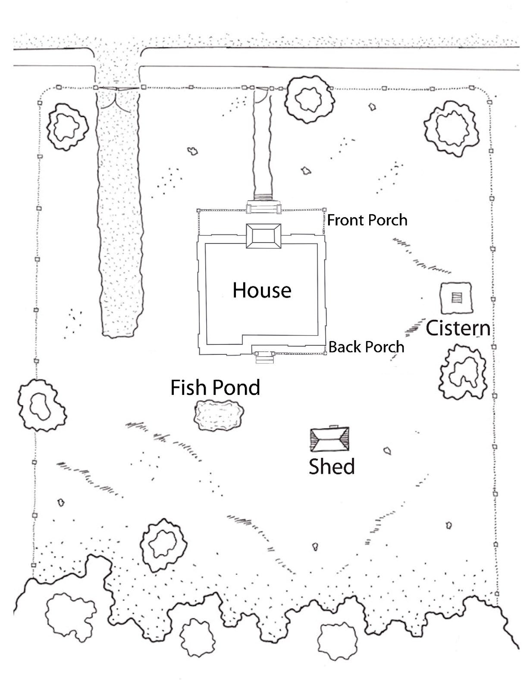

# Карты и раздатка

## Карта участка

Подписи на карте:

- Front Porch — парадное крыльцо;
- House — дом;
- Cistern — цистерна;
- Back Porch — заднее крыльцо;
- Fish Pond — пруд;
- Shed — сарай;
- Exterior Map — карта участка.

*Ограда, ворота, калитка и деревья нарисованы без подписей.*
