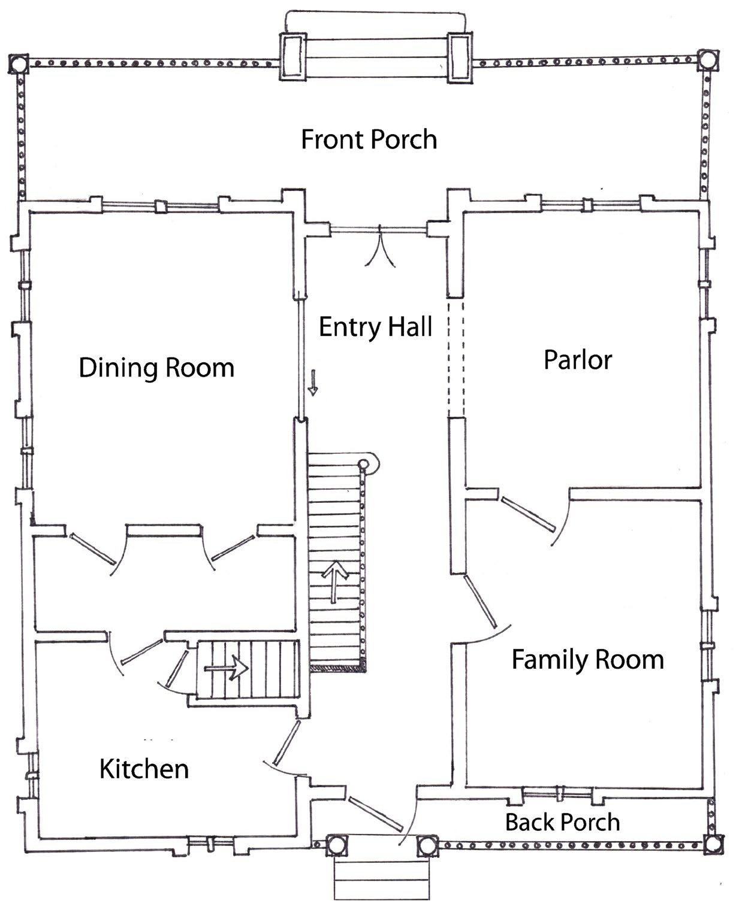

## План первого этажа

Подписи на карте:

- Front Porch — парадное крыльцо;
- Entry Hall — прихожая;
- Dining Room — столовая;
- Parlor — гостиная для приёмов;
- Family Room — общая комната;
- Kitchen — кухня;
- Back Porch — заднее крыльцо;
- Ground Floor Map — план первого этажа.

*Прим. перев.: на карте комната подписана «Family Room», в тексте она называется «The Living Room» — это одна и та же общая комната.*
