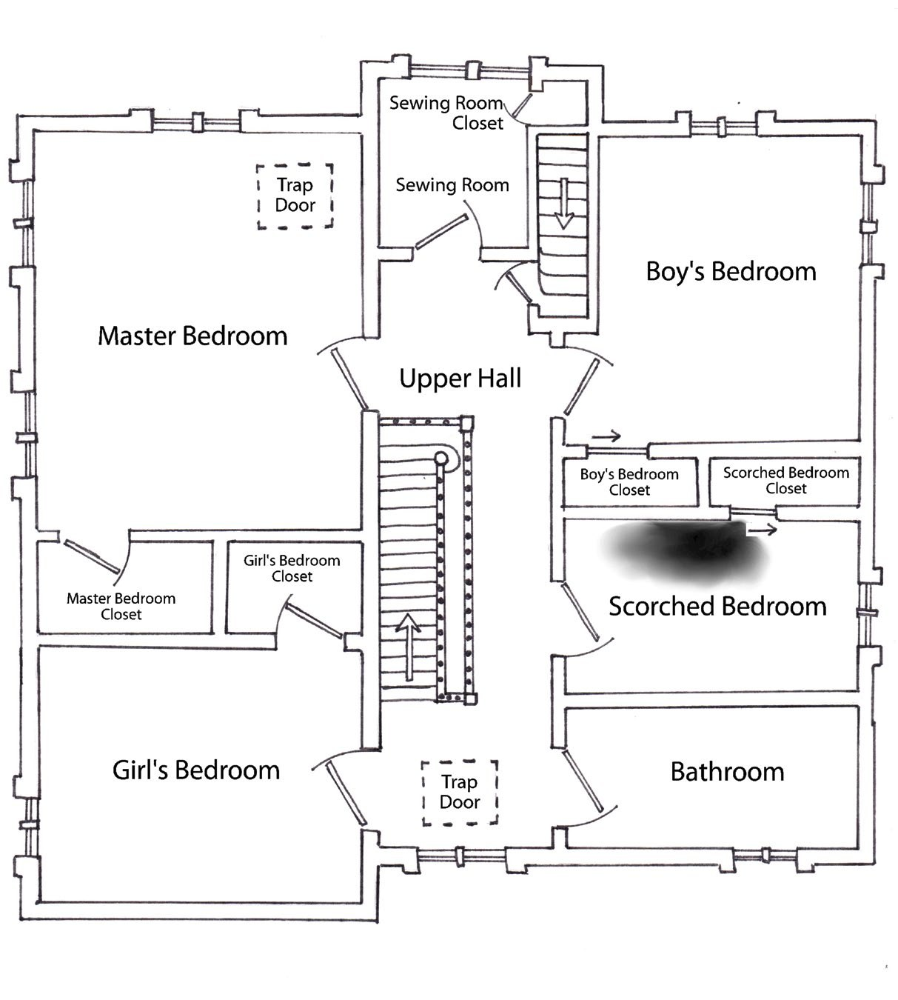

## План второго этажа

Подписи на карте:

- Sewing Room — швейная комната;
- Sewing Room Closet — чулан швейной комнаты;
- Master Bedroom — хозяйская спальня;
- Master Bedroom Closet — большой чулан хозяйской спальни;
- Trap Door — люк (на чердак; на плане их два — в хозяйской спальне и в верхнем коридоре);
- Boy’s Bedroom — спальня мальчика;
- Boy’s Bedroom Closet — чулан спальни мальчика;
- Upper Hall — верхний коридор;
- Scorched Bedroom — обожжённая спальня;
- Scorched Bedroom Closet — чулан обожжённой спальни;
- Girl’s Bedroom — спальня девочки;
- Girl’s Bedroom Closet — чулан спальни девочки;
- Bathroom — ванная;
- Upper Floor Map — план второго этажа.
