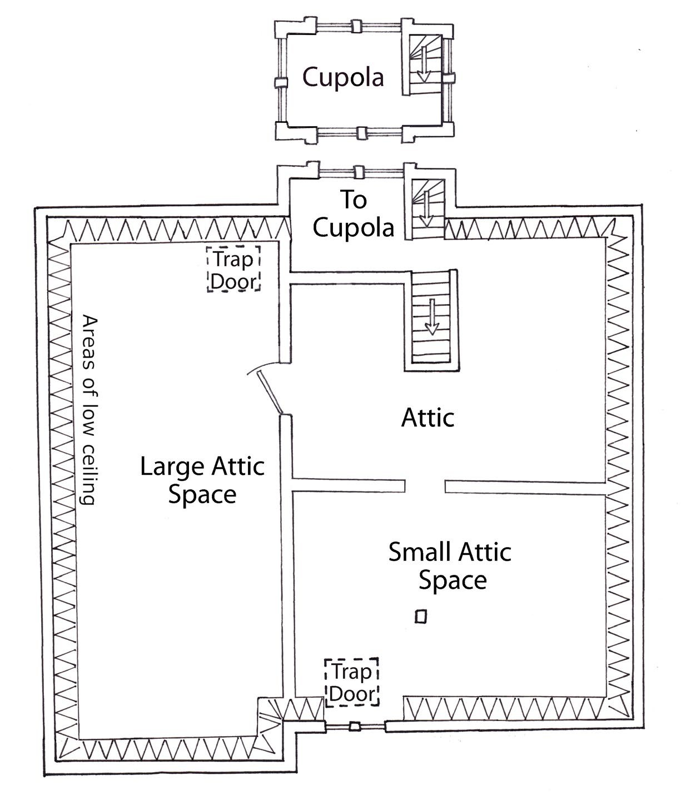

## План чердака

Подписи на карте:

- Cupola — купол;
- To Cupola — в купол (лестница);
- Attic — чердак;
- Large Attic Space — большое чердачное помещение;
- Small Attic Space — малое чердачное помещение;
- Areas of low ceiling — места с низким потолком;
- Trap Door — люк (на плане их два);
- Attic Map — план чердака.
