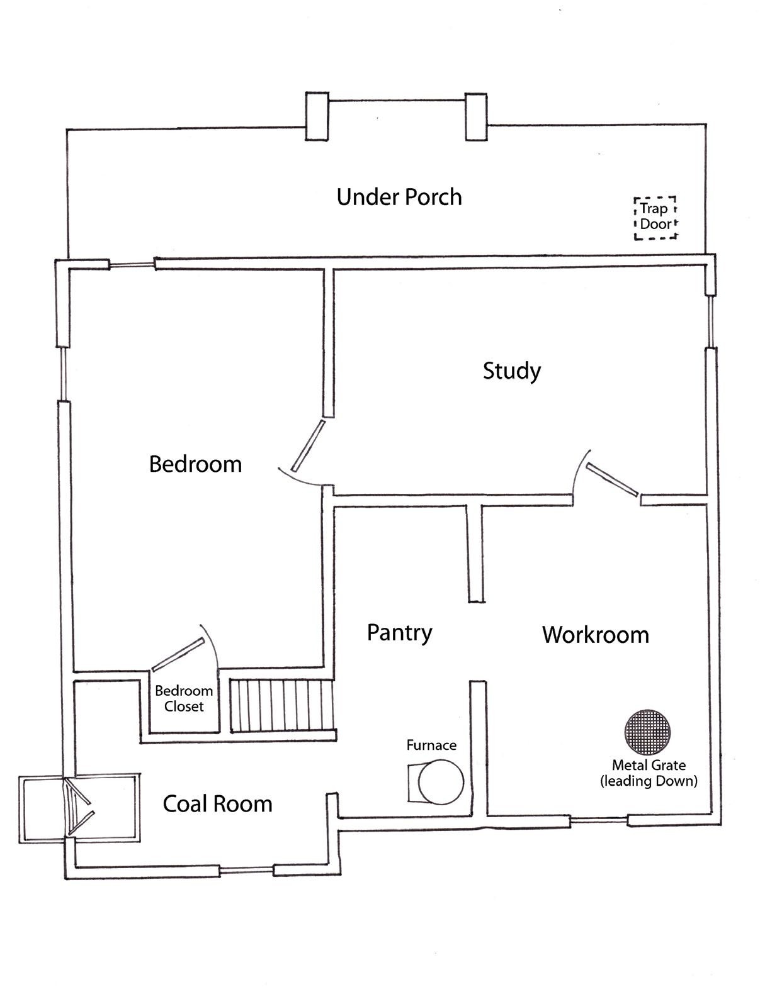

## План подвала

Подписи на карте:

- Under Porch — подполье под крыльцом;
- Trap Door — люк;
- Study — кабинет;
- Bedroom — спальня;
- Bedroom Closet — чулан спальни;
- Pantry — кладовая;
- Furnace — печь;
- Workroom — мастерская;
- Metal Grate (leading Down) — металлическая решётка (ведёт вниз);
- Coal Room — угольная;
- Basement Map — план подвала.
