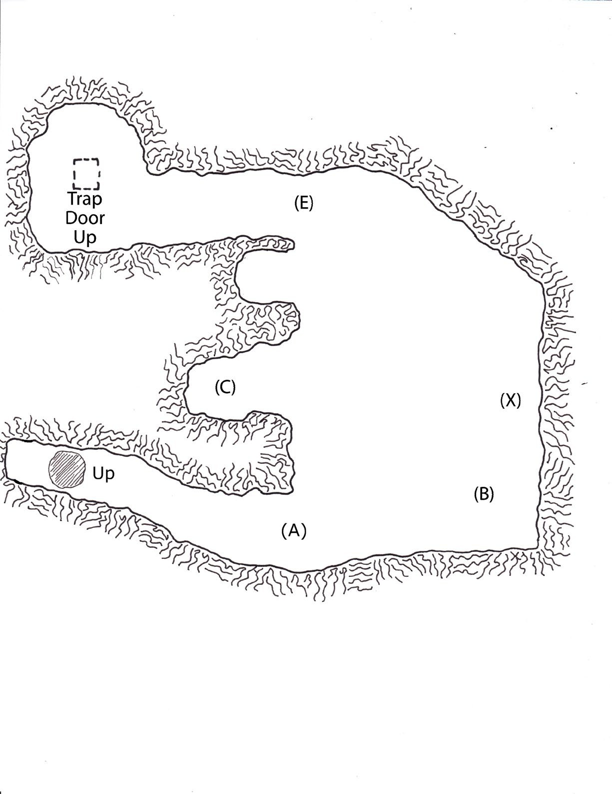

## План туннелей

Подписи на карте:

- Trap Door Up — люк наверх (под парадное крыльцо);
- Up — наверх (к решётке в мастерской);
- (A), (B), (C), (E), (X) — метки ключа к плану туннелей (ключ — на с. 27 оригинала);
- Tunnels Map — план туннелей.

*Прим. перев.: ключ к плану (с. 27) описывает метки TD и A–F, а на самом плане стоят TD, E, C, X, Up, B и A: меток D (ниша Эвелин) и F (туннель к люку под крыльцом) на плане нет, угол с кирпичной кладкой цистерны в тексте отмечен «X», а метки B и A стоят не там, где их помещает ключ.*
