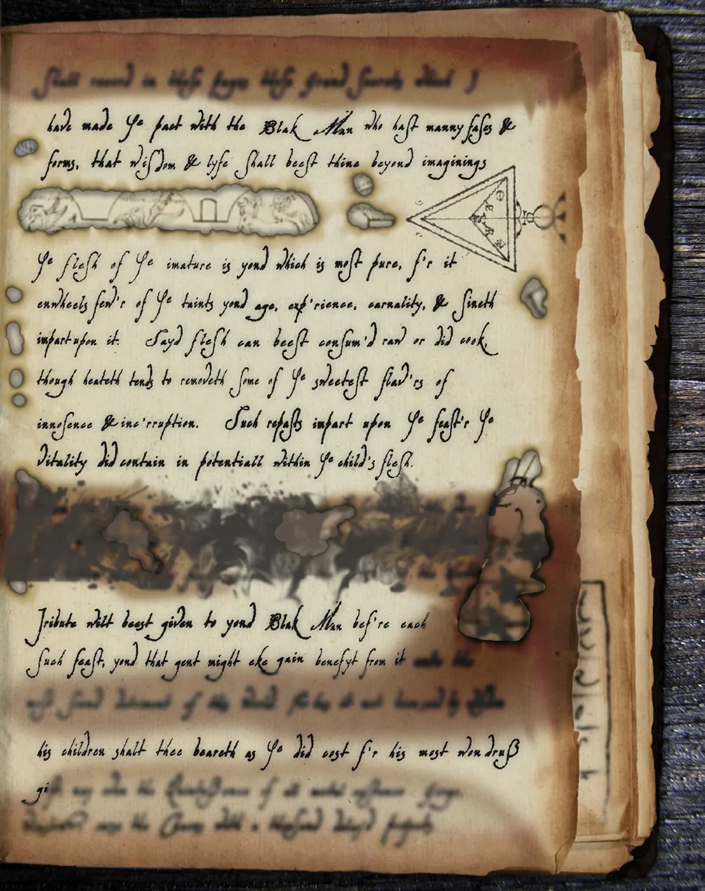

## Раздатка 1

> **Раздатка 1: страница гримуара Эвелин**
>
> *[Размыто: Запишу на сих страницах великие тайны, коими я]*
> заключила договор с Чёрным человеком, у коего многие лица и обличья, дабы мудрость и жизнь стали твоими сверх всякого воображения.
>
> Плоть незрелых — та, что чище всего, ибо несёт она меньше той скверны, коей наделяют её годы, опыт, плотское и грех. Сию плоть можно вкушать сырой или приготовленной, хотя жар отнимает часть сладчайших вкусов невинности и нетленности. Такие трапезы передают пирующему ту жизненную силу, что в возможности таилась в плоти дитяти.
>
> *[Строки скрыты пятном.]*
>
> Дань будет воздаваема оному Чёрному человеку пред каждым таким пиршеством, дабы и сей господин получил от неё выгоду *[размыто]*
>
> *[размыто]*
>
> чад его будешь ты рожать, ибо такова цена за его чудеснейший дар *[размыто]*
