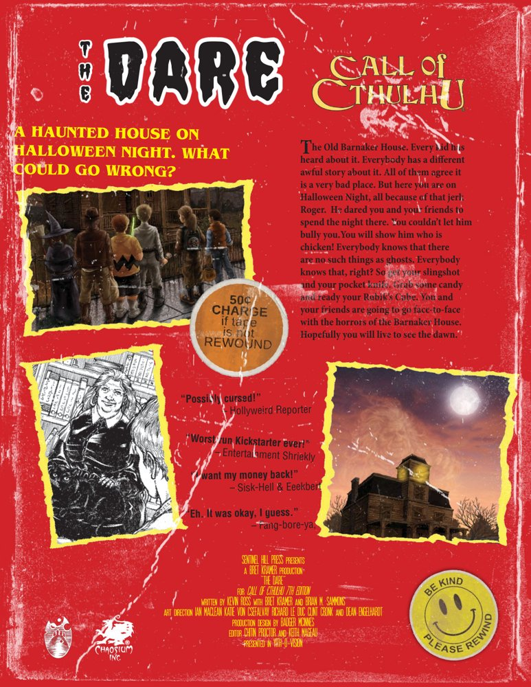

## Задняя обложка

**НА СПОР**

**ДОМ С ПРИВИДЕНИЯМИ В НОЧЬ ХЭЛЛОУИНА. ЧТО МОЖЕТ ПОЙТИ НЕ ТАК?**

Старый дом Барнакеров. О нём слышал каждый ребёнок. У всех своя жуткая история о нём. И все согласны: место очень плохое. Но вот вы здесь, в ночь Хэллоуина, — и всё из-за этого придурка Роджера. Он поспорил с тобой и твоими друзьями, что вы не проведёте там ночь. Нельзя же позволить ему себя травить. Ты покажешь ему, кто тут трусишка! Все знают, что привидений не бывает. Все ведь это знают, правда? Так что бери рогатку и перочинный ножик. Прихвати конфет и приготовь кубик Рубика. Вам с друзьями предстоит встретиться лицом к лицу с ужасами дома Барнакеров. Будем надеяться, вы доживёте до рассвета.

«Возможно, проклято!» — *Голливудский чудик* (Hollyweird Reporter)

«Худший Kickstarter в истории!» — *Развлекательный визг* (Entertainment Shriekly)

«Верните мои деньги!» — *Сиск-Ад и Ииикберт* (Sisk-Hell & Eeekbert)

«Э-э. Ну, вроде ничего». — *Клык-зануда* (Fang-bore-ya)

Наклейки видеопроката: «50 центов штрафа, если кассета не перемотана» и «Будьте добры, перемотайте» (со смайликом).

*Титры в духе видеокассеты:* SENTINEL HILL PRESS представляет постановку БРЕТА КРАМЕРА «НА СПОР» для «ЗОВА КТУЛХУ», 7-я редакция. Сценарий — КЕВИН РОСС при участии БРЕТА КРАМЕРА и БРАЙАНА М. САММОНСА. Художественное руководство — ЙЕН МАКЛИН, КЕЙТИ ФОН ЧЕФАЛВАИ, РИЧАРД ЛЕ ДЮК, КЛИНТ КРОНК и ДИН ЭНГЕЛЬХАРДТ. Художник-постановщик — БАДЖЕР МАКИННЕС. Редакторы — ЧИТИН ПРОКТОР и КИТ МАЖО. Показано в системе YITH-O-VISION.

*На обложке — кадры «видеокассеты»: дети в маскарадных костюмах у ограды дома, ведьма в библиотеке, дом Барнакеров под полной луной; логотипы «Call of Cthulhu», Sentinel Hill Press и Chaosium.*

*Прим. перев.: отзывы — пародии на издания и кинокритиков (The Hollywood Reporter, Entertainment Weekly, Siskel & Ebert, Fangoria); названия переведены с сохранением шутки, оригинал — в скобках. «Yith-o-Vision» — пародия на технологии кинопоказа (по имени Великой Расы Йита).*
