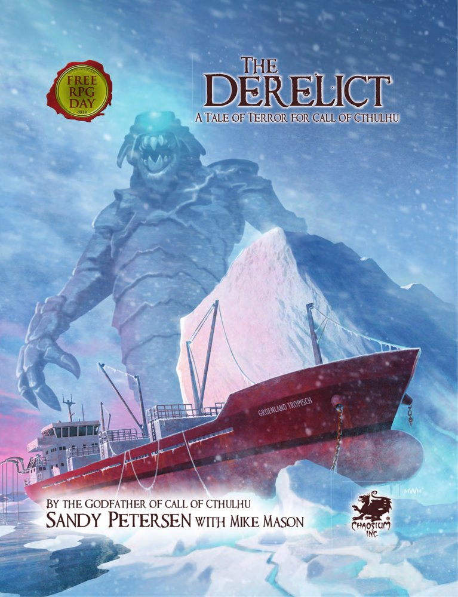

БРОШЕННОЕ СУДНО

Рассказ ужасов для «Зова Ктулху»

От крёстного отца «Зова Ктулху» — Сэнди Петерсен при участии Майка Мейсона

*На обложке (худ. М. Уэйн Миллер) — призрачный скиапод с горящим глазом нависает над красным рефрижератором «Гренланд Тропиш», застрявшим на айсберге посреди метели; печать Free RPG Day, логотип Chaosium. Номер издания — 23150.*

## Задняя обложка

**Брошенное судно. Рассказ ужасов для «Зова Ктулху»**

Рассказ ужасов Сэнди Петерсена.

Ледяные воды Северной Атлантики хранят много тайн.
Одну из них вот-вот откроют…

Несмотря на все заботы и тревоги жизни, роскошная яхта «Делайла» отправляется в последний рейс — из Америки к новому владельцу в Англию. То, что обещало быть приятным путешествием по океанским волнам, оборачивается отчаянной борьбой за выживание.

«Брошенное судно» — сценарий в современности для шести игроков (или меньше); его можно сыграть за одну встречу. В нём есть советы, как помочь игрокам создать самых разных персонажей.

Застрявшее судно. Обещание огромной награды. Тайна, полная ужаса.

Если вы играете в «Зов Ктулху» впервые, вам понадобятся либо «Правила быстрого старта» (*Call of Cthulhu Quick-Start Rules*, 7-я редакция) — бесплатно на www.chaosium.com, — либо «Книга правил» (*Call of Cthulhu Rulebook*, 7-я редакция), которую можно купить в ближайшем магазине настольных игр или прямо у Chaosium.

*Внизу задней обложки — логотипы Free RPG Day, «Call of Cthulhu» и Chaosium Inc.*
