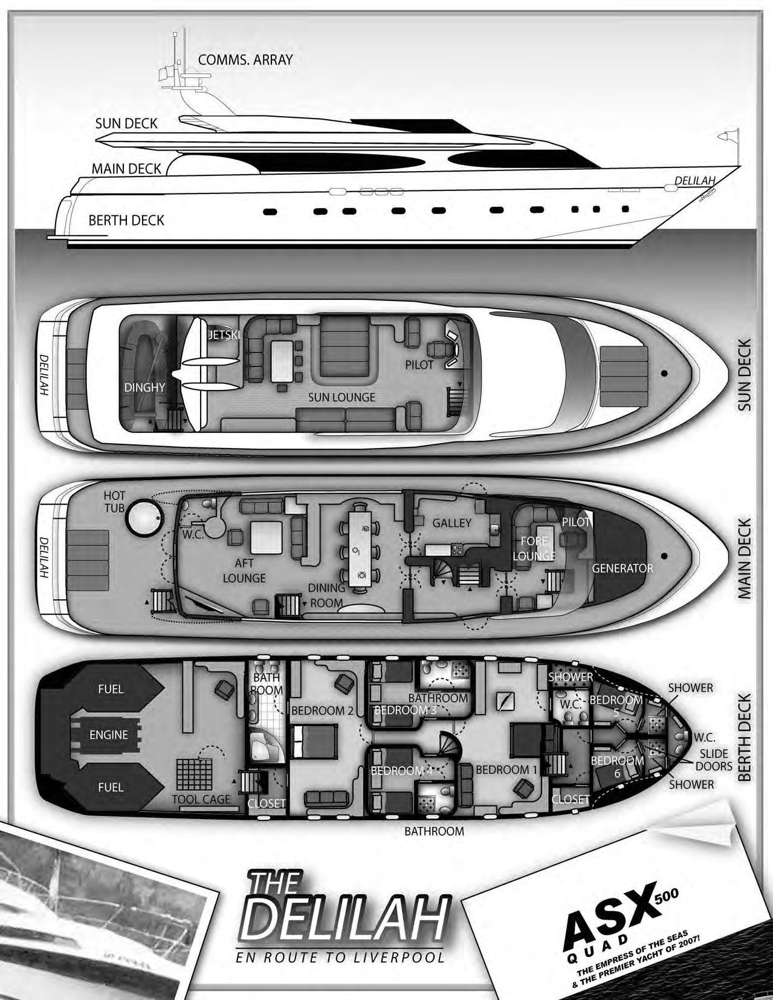

## План палуб «Делайлы»

**Подписи на плане**

| На плане | Перевод |
|---|---|
| **Разрез (сбоку)** | |
| COMMS. ARRAY | антенны связи |
| SUN DECK / MAIN DECK / BERTH DECK | солнечная палуба (флайбридж) / главная палуба / нижняя палуба |
| DELILAH | «Делайла» (название на борту) |
| **SUN DECK — солнечная палуба** | |
| DINGHY | шлюпка (динги) |
| JETSKI | гидроцикл |
| SUN LOUNGE | зона отдыха |
| PILOT | дублирующий пост управления |
| **MAIN DECK — главная палуба** | |
| HOT TUB | гидромассажная ванна |
| W.C. | туалет |
| AFT LOUNGE | кормовой салон |
| DINING ROOM | столовая |
| GALLEY | камбуз |
| FORE LOUNGE | носовой салон |
| PILOT | рулевая рубка |
| GENERATOR | генератор |
| **BERTH DECK — нижняя палуба** | |
| FUEL | топливная цистерна (две) |
| ENGINE | двигатель |
| TOOL CAGE | клетка с инструментами |
| BATHROOM / BATH ROOM | ванная |
| CLOSET | кладовая |
| BEDROOM 1–4 | каюты 1–4 |
| BEDROOM 5, BEDROOM 6 | носовые каюты 5 и 6 |
| SHOWER | душевая |
| W.C. | туалет |
| SLIDE DOORS | раздвижные двери |
| **Внизу листа** | |
| THE DELILAH — EN ROUTE TO LIVERPOOL | «Делайла» — на пути в Ливерпуль |
| ASX 500 QUAD — THE EMPRESS OF THE SEAS & THE PREMIER YACHT OF 2007! | рекламный буклет: «ASX 500 Quad — императрица морей и лучшая яхта 2007 года!» |
