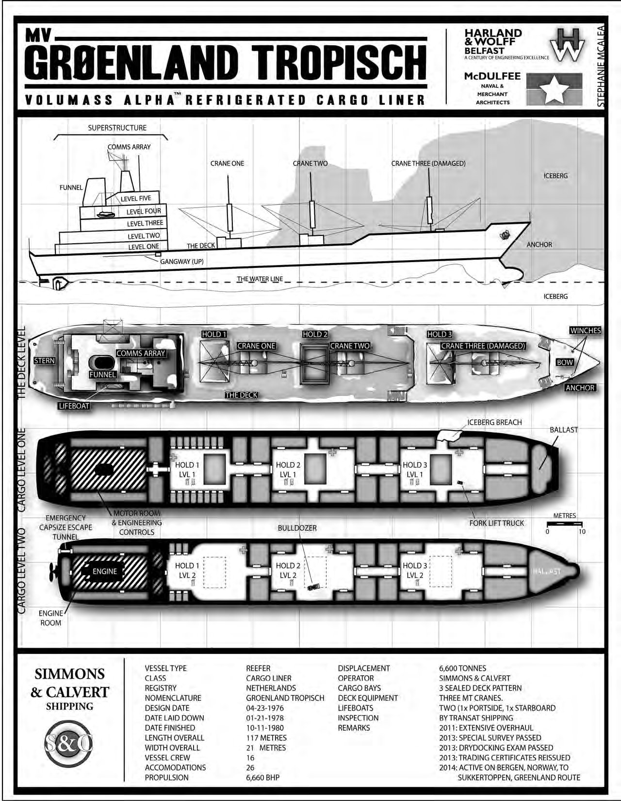

## План «Гренланд Тропиш»

**Подписи на плане**

| На плане | Перевод |
|---|---|
| MV GRØENLAND TROPISCH — VOLUMASS ALPHA™ REFRIGERATED CARGO LINER | теплоход «Гренланд Тропиш» — рефрижераторный грузовой лайнер Volumass Alpha™ |
| HARLAND & WOLFF, BELFAST — A CENTURY OF ENGINEERING EXCELLENCE | «Харланд энд Вулф», Белфаст — век инженерного мастерства |
| McDULFEE NAVAL & MERCHANT ARCHITECTS | «Макдалфи», конструкторы военных и торговых судов |
| **Разрез (сбоку)** | |
| SUPERSTRUCTURE; LEVEL ONE … LEVEL FIVE | надстройка; уровни с первого по пятый |
| COMMS ARRAY | антенны связи |
| FUNNEL | дымовая труба |
| GANGWAY (UP) | сходня (поднята) |
| THE DECK | палуба |
| CRANE ONE / CRANE TWO / CRANE THREE (DAMAGED) | кран 1 / кран 2 / кран 3 (повреждён) |
| ICEBERG | айсберг (и его подводная часть) |
| ANCHOR | якорь |
| THE WATER LINE | ватерлиния |
| **THE DECK LEVEL — палубный уровень** | |
| STERN / BOW | корма / нос |
| LIFEBOAT | спасательная шлюпка |
| HOLD 1, HOLD 2, HOLD 3 | трюм 1, трюм 2, трюм 3 (люки) |
| WINCHES | лебёдки |
| **CARGO LEVEL ONE — первый грузовой уровень** | |
| HOLD 1 LVL 1 … HOLD 3 LVL 1 | трюмы 1–3, уровень 1 |
| ICEBERG BREACH | пробоина от айсберга |
| BALLAST | балласт |
| MOTOR ROOM & ENGINEERING CONTROLS | моторное отделение и пульт управления механизмами |
| FORK LIFT TRUCK | вилочный погрузчик |
| EMERGENCY CAPSIZE ESCAPE TUNNEL | аварийный туннель на случай опрокидывания |
| METRES 0–10 | масштаб, метры (0–10) |
| **CARGO LEVEL TWO — второй грузовой уровень** | |
| ENGINE; ENGINE ROOM | двигатель; машинное отделение |
| BULLDOZER | бульдозер |
| HOLD 1 LVL 2 … HOLD 3 LVL 2 | трюмы 1–3, уровень 2 |

**Паспорт судна (SIMMONS & CALVERT SHIPPING, «Симмонс и Калверт», судоходство; логотип S&C)**

| Поле | Значение |
|---|---|
| Тип судна | рефрижератор |
| Класс | грузовой лайнер |
| Регистр | Нидерланды |
| Название | Groenland Tropisch («Гренланд Тропиш») |
| Дата проекта | 23.04.1976 |
| Закладка | 21.01.1978 |
| Окончание постройки | 11.10.1980 |
| Длина наибольшая | 117 метров |
| Ширина наибольшая | 21 метр |
| Экипаж | 16 |
| Мест | 26 |
| Мощность | 6 660 л. с. |
| Водоизмещение | 6 600 тонн |
| Оператор | «Симмонс и Калверт» |
| Грузовые отсеки | 3, с герметичными палубными люками |
| Палубное оборудование | три крана |
| Спасательные шлюпки | две (по одной у левого и правого борта) |
| Освидетельствование | Transat Shipping |
| Отметки | 2011: капитальный ремонт; 2013: специальное освидетельствование пройдено; 2013: освидетельствование в доке пройдено; 2013: торговые сертификаты переоформлены; 2014: работает на линии Берген (Норвегия) — Суккертоппен (Гренландия) |

*Прим. перев.: в тексте (с. 9) — «валовая вместимость 6 600», на плане — «водоизмещение 6 600 тонн»; оба числа переданы как напечатаны.*
