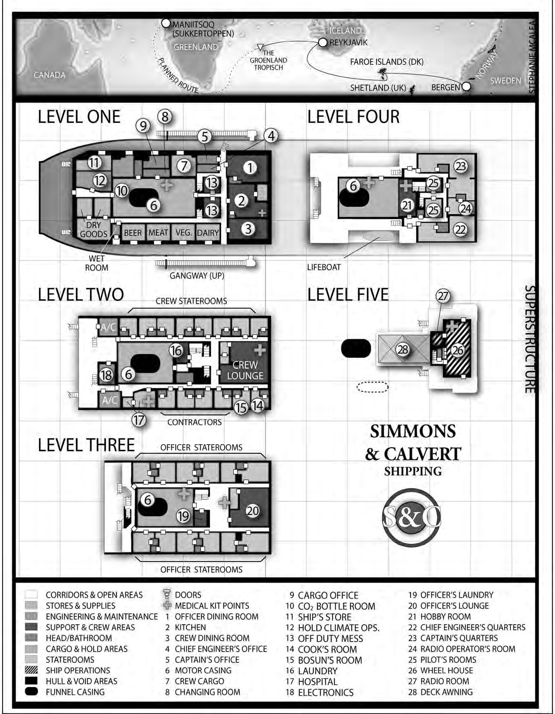

## План «Гренланд Тропиш»: надстройка

**Карта маршрута (вверху листа)**

| На карте | Перевод |
|---|---|
| MANIITSOQ (SUKKERTOPPEN) | Маниитсок (Суккертоппен) — порт назначения |
| GREENLAND / CANADA / ICELAND | Гренландия / Канада / Исландия |
| PLANNED ROUTE | плановый маршрут |
| THE GROENLAND TROPISCH | «Гренланд Тропиш» (где оказалось судно) |
| REYKJAVIK | Рейкьявик |
| FAROE ISLANDS (DK) / SHETLAND (UK) | Фарерские острова (Дания) / Шетландские острова (Великобритания) |
| BERGEN / NORWAY / SWEDEN | Берген — порт отправления / Норвегия / Швеция |

**Подписи на планах уровней**

| На плане | Перевод |
|---|---|
| LEVEL ONE … LEVEL FIVE | уровни с первого по пятый |
| SUPERSTRUCTURE | надстройка |
| DRY GOODS / BEER / MEAT / VEG. / DAIRY | сухие продукты / пиво / мясо / овощи / молочные продукты (продовольственные кладовые) |
| WET ROOM | мойка |
| GANGWAY (UP) | сходня (поднята) |
| LIFEBOAT | спасательная шлюпка |
| CREW STATEROOMS | каюты экипажа |
| CONTRACTORS | каюты подрядчиков |
| CREW LOUNGE | кают-компания экипажа |
| A/C | кондиционер |
| OFFICER STATEROOMS | каюты офицеров |
| SIMMONS & CALVERT SHIPPING (S&C) | «Симмонс и Калверт», судоходство (логотип) |

**Условные обозначения**

| На плане | Перевод |
|---|---|
| CORRIDORS & OPEN AREAS | коридоры и открытые места |
| STORES & SUPPLIES | кладовые и запасы |
| ENGINEERING & MAINTENANCE | машинные и ремонтные помещения |
| SUPPORT & CREW AREAS | служебные помещения и помещения экипажа |
| HEAD/BATHROOM | гальюн / санузел |
| CARGO & HOLD AREAS | грузовые помещения и трюмы |
| STATEROOMS | каюты |
| SHIP OPERATIONS | посты управления судном |
| HULL & VOID AREAS | корпус и пустоты |
| FUNNEL CASING | кожух дымовой трубы |
| DOORS | двери |
| MEDICAL KIT POINTS | аптечки |

**Номера помещений**

| № | На плане | Перевод |
|---|---|---|
| 1 | Officer Dining Room | столовая офицеров |
| 2 | Kitchen | камбуз |
| 3 | Crew Dining Room | столовая экипажа |
| 4 | Chief Engineer’s Office | кабинет старшего механика |
| 5 | Captain’s Office | кабинет капитана |
| 6 | Motor Casing | шахта машинного отделения |
| 7 | Crew Cargo | склад экипажа |
| 8 | Changing Room | раздевалка |
| 9 | Cargo Office | грузовая контора |
| 10 | CO2 Bottle Room | помещение баллонов CO2 |
| 11 | Ship’s Store | судовая кладовая |
| 12 | Hold Climate Ops. | пост климат-контроля трюмов |
| 13 | Off Duty Mess | комната отдыха вахты |
| 14 | Cook’s Room | каюта кока |
| 15 | Bosun’s Room | каюта боцмана |
| 16 | Laundry | прачечная |
| 17 | Hospital | лазарет |
| 18 | Electronics | помещение электроники |
| 19 | Officer’s Laundry | прачечная офицеров |
| 20 | Officer’s Lounge | кают-компания офицеров |
| 21 | Hobby Room | комната отдыха |
| 22 | Chief Engineer’s Quarters | каюта старшего механика |
| 23 | Captain’s Quarters | каюта капитана |
| 24 | Radio Operator’s Room | каюта радиста |
| 25 | Pilot’s Rooms | каюты лоцмана |
| 26 | Wheel House | рулевая рубка |
| 27 | Radio Room | радиорубка |
| 28 | Deck Awning | навес над палубой |
