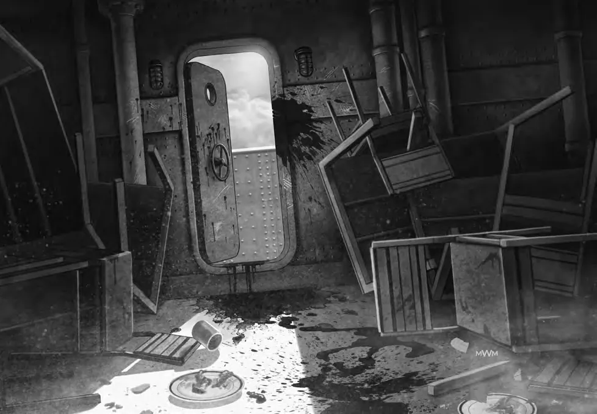

…(антибиотики, пенициллин и т. п.); на полу — несколько разбитых ампул морфина. Сыщик с медицинской подготовкой поймёт, что здесь можно делать операции и обычные медицинские процедуры.

**Возможные находки:**

- Пятна крови.
- Брошенный топорик.
- Пустая ампула из-под морфина и использованный шприц.
- Потускневший окровавленный нож.
- Каюта экипажа, забрызганная замёрзшей кровью.

## Надстройка: уровень три, каюты офицеров

Планировка — как уровнем ниже; каюты офицеров чуть больше, чем у экипажа. Кроме ещё одной прачечной, здесь есть только кают-компания офицеров — тоже с баром (заперт), а кресла и столы чуть получше. На полу валяются пустые бутылки из-под виски (видимо, вынесенные из бара); некоторые разбиты, и острые осколки опасны для того, кто упадёт на пол или станет шарить по нему на четвереньках.

**Возможные находки:**

- Цилиндрический кусок стекла длиной 2 метра, вонзившийся в переборку (издалека в луче фонаря он поблёскивает). Вблизи стекло больше похоже на кристалл, а формой — на гарпун. Если вытащить его из стены (для этого нужна трудная проверка **СИЛ**), кристаллическое древко оказывается ледяным на ощупь, а наконечник — острым и зазубренным. Ничего подобного сыщики прежде не видели: материал больше всего похож на бронестекло и очень прочен (см. **Скиапод**, с. 21).
- По меньшей мере одна дверь каюты сорвана с петель и теперь наполовину загораживает коридор.
- Мёртвый моряк в прачечной. Тело выпотрошено и частично съедено (потеря Рассудка 1/1d4).
- Заряженный сигнальный пистолет (1d10+3+горение).

*Прим. перев.: так в оригинале — «с. 21»; раздел «Скиапод» — на с. 22, а на с. 21 — «Борьба со скиаподом».*
