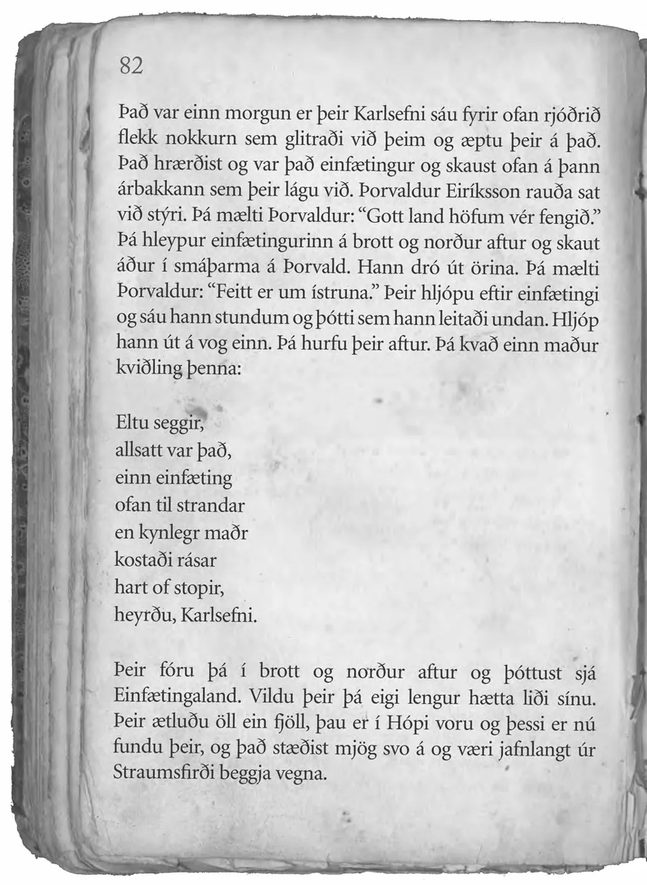

> **Раздатка «Брошенное судно» 1: страницы «Саги об Эйрике Рыжем» — левая страница (с. 82)**
>
> *Древнеисландский текст «Саги об Эйрике Рыжем» (оставлен как напечатан; перевод того же отрывка — на правой странице, с. 83, следующая страница).*
>
> Það var einn morgun er þeir Karlsefni sáu fyrir ofan rjóðrið flekk nokkurn sem glitraði við þeim og æptu þeir á það. Það hrærðist og var það einfætingur og skaust ofan á þann árbakkann sem þeir lágu við. Þorvaldur Eiríksson rauða sat við stýri. Þá mælti Þorvaldur: “Gott land höfum vér fengið.” Þá hleypur einfætingurinn á brott og norður aftur og skaut áður í smáþarma á Þorvald. Hann dró út örina. Þá mælti Þorvaldur: “Feitt er um ístruna.” Þeir hljópu eftir einfætingi og sáu hann stundum og þótti sem hann leitaði undan. Hljóp hann út á vog einn. Þá hurfu þeir aftur. Þá kvað einn maður kviðling þenna:
>
> *Eltu seggir,* 
> *allsatt var það,* 
> *einn einfæting* 
> *ofan til strandar* 
> *en kynlegr maðr* 
> *kostaði rásar* 
> *hart of stopir,* 
> *heyrðu, Karlsefni.*
>
> Þeir fóru þá í brott og norður aftur og þóttust sjá Einfætingaland. Vildu þeir þá eigi lengur hætta liði sínu. Þeir ætluðu öll ein fjöll, þau er í Hópi voru og þessi er nú fundu þeir, og það stæðist mjög svo á og væri jafnlangt úr Straumsfirði beggja vegna.
