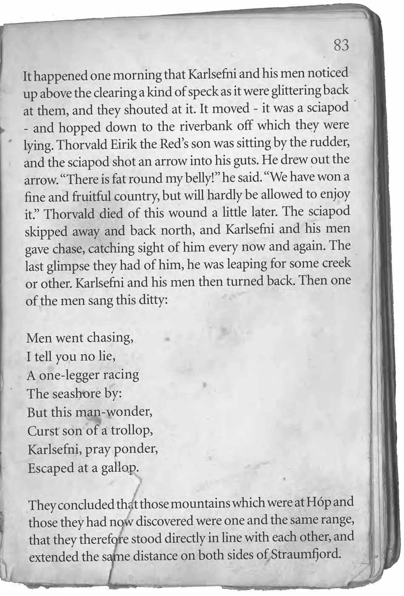

> **Раздатка «Брошенное судно» 1: страницы «Саги об Эйрике Рыжем» — правая страница (с. 83)**
>
> Случилось однажды утром, что Карлсефни и его люди заметили над поляной какое-то пятнышко, будто блестевшее им в ответ, и окликнули его. Оно зашевелилось — это был скиапод — и поскакало вниз, к берегу реки, у которого стояли их корабли. Торвальд, сын Эйрика Рыжего, сидел у руля, и скиапод пустил стрелу ему в живот. Торвальд вытащил стрелу. «Жирок-то у меня на брюхе есть!» — сказал он. — «Добрую и плодородную страну мы добыли, да вряд ли дадут нам ею насладиться». Немного спустя Торвальд умер от этой раны. Скиапод ускакал прочь, обратно на север, а Карлсефни и его люди погнались за ним и время от времени видели его. В последний раз они заметили его, когда он прыгал к какому-то ручью. Тогда Карлсефни и его люди повернули назад. И один из них пропел такую песенку:
>
> *Гнались мы, люди, —* 
> *Правду скажу я, —* 
> *За одноногим,* 
> *Мчавшим по взморью;* 
> *Но это диво,* 
> *Шлюхино семя,* 
> *Карлсефни, слышишь,* 
> *Ускакало галопом.*
>
> Они решили, что горы у Хопа и те, что они открыли теперь, — один и тот же хребет, что горы, стало быть, стоят прямо друг против друга и тянутся на одинаковое расстояние по обе стороны от Страумфьорда.

*На полях страницы — подпись «Handout: Derelict 1 – Pages from Erik the Red’s Saga» («Раздатка „Брошенное судно“ 1 — страницы „Саги об Эйрике Рыжем“»).*
