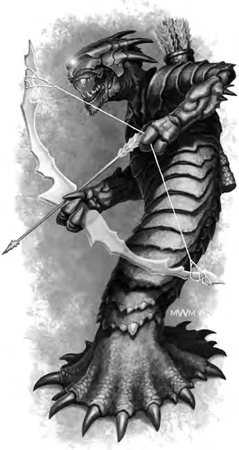

## Ранен?

Когда скиапод сдастся, решает Хранитель. Он может решить драться насмерть (он не особенно умён) или, тяжело раненный, уползти зализывать раны — это хотя бы даст сыщикам время придумать новый план, починить яхту, бежать на шлюпке и так далее. Во всяком случае, потеряв половину пунктов здоровья, чудовище отступит и перегруппируется. Тяжело раненный и загнанный в угол, скиапод скорее всего впадёт в ярость и отчаяние и ударит изо всех сил, чтобы вырваться.

# Развязка

Заранее заданного исхода у сценария нет. Может быть, сыщики убьют скиапода, и у них будет время починить яхту. Может быть, поймают его — хотя рано или поздно он, скорее всего, вырвется, — и, возможно, это даст им достаточно времени, чтобы уйти от айсберга на шлюпке с рефрижератора или пустить «Делайлу» в дрейф. Разумеется, несмотря на изобретательные планы и героизм, победа может остаться за чудовищем, и сыщики станут его следующим обедом. Если по радио в самом начале успели отправить сообщение, то проходящее судно или даже спасательная команда могут появиться (когда со скиаподом так или иначе разберутся) и помочь сыщикам уйти в безопасное место.

Если сыщики выжили и уходят на шлюпках или их спасают, Хранителю предлагается описать финальную сцену так:



> *Вы отталкиваетесь и уходите в тёмные воды Северной Атлантики. Хорошо бы вас поскорее нашло проходящее судно, хотя в глубине души вы знаете, что шансы невелики. Может быть, вы переборете голод, жажду и холод и останетесь живы, чтобы рассказать эту историю. Во всяком случае, это лучше, чем страшная участь экипажа «Гренланд Тропиш» и ваших друзей, которым не повезло.*
>
> *Прижавшись друг к другу, отчаянно пытаясь согреться, вы оглядываетесь на айсберг и старый рефрижератор. Картина почти живописная. Даже ветер будто стих. И вдруг что-то белое шевелится, сдвигается и падает с айсберга в тёмную воду, подняв большой фонтан брызг. Вы очень устали; глаза, должно быть, вас обманывают; не может же эта тварь плыть за вами…*

# Приложение

## Неигровые персонажи

### Капитан яхты

```stat
СИЛ 60    ВЫН 60    ТЕЛ 65    ЛВК 60    ИНТ 70
НАР 55    МОЩ 40    ОБР 65    Рассудок 60   ПЗ 12
БкУ: +1d4   Комплекция: 1   СКО: 7   ПМ: 8

Ближний бой (драка)   30% (15/6), урон 1d3 + 1d4,
                      или дубинка 1d4 + 1d4
Уклонение             30% (15/6)

Навыки: Лазание 40%, Подводное плавание 45%, Электрика 35%, Первая помощь 70%, Запугивание 45%, Юриспруденция 30%, Слух 40%, Механика 65%, Естествознание 55%, Ориентирование 75%, Управление тяжёлыми машинами 25%, Пилотирование (лодка) 80%, Психология 40%, Наука (инженерия) 20%, Внимание 50%, Плавание 65%, Метание 40%.
```

### Помощник капитана

```stat
СИЛ 50    ВЫН 70    ТЕЛ 55    ЛВК 70    ИНТ 70
НАР 60    МОЩ 45    ОБР 60    Рассудок 45   ПЗ 12
БкУ: 0    Комплекция: 0   СКО: 8 / 9 вплавь   ПМ: 9

Ближний бой (драка)   30% (15/6), урон 1d3 + 1d4,
                      или нож 1d4 + 1d4
Уклонение             35% (17/7)

Навыки: Обаяние 45%, Лазание 45%, Первая помощь 45%, Электрика 70%, Механика 55%, Естествознание 35%, Ориентирование 60%, Управление тяжёлыми машинами 65%, Пилотирование (лодка) 70%, Наука (инженерия) 40%, Внимание 40%, Плавание 50%, Метание 50%.
```

*Прим. перев.: имён у этих NPC в книге нет; в базе им даны имена Гленн Хардинг (капитан яхты) и Кевин Риордан (помощник капитана). У помощника так в оригинале — БкУ 0, но в уроне напечатано «+ 1d4», как у капитана.*

## Скиапод

*То, что сначала казалось большой неровной бледной каменной глыбой, приподняло свою тушу, и под ней открылось тело. Каменистый «зонтик» сверху оказался огромной цепкой ногой, раскинутой и наклонённой так, чтобы прикрывать тело, — как у какого-то адского моллюска. Подобрав ногу под себя, чтобы встать на эту мясистую массу, оно поднялось и рванулось вперёд. Чудовищная тварь из белой мышечной массы, которая извивалась и корчилась, принимая подобие человеческого торса с двумя руками, переходящими в перепончатые кисти и пальцы. А сверху, вырастая из середины туши, — уродливая голова с зияющей пастью, полной острых как бритва зубов, и единственным светящимся зелёным глазом.*
