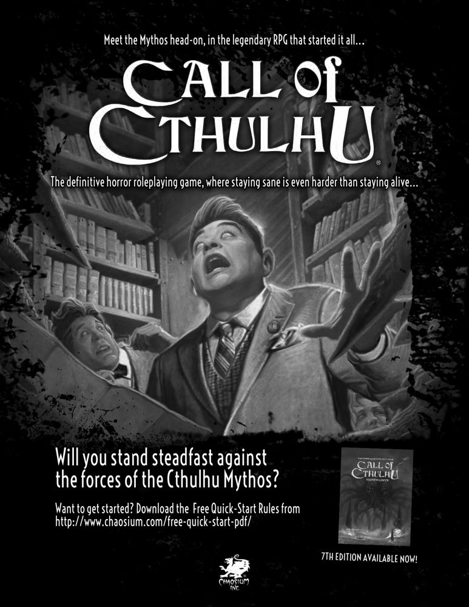

*Рекламная страница: иллюстрация — перепуганные сыщики среди книжных полок старой библиотеки; логотип «Call of Cthulhu», обложка «Книги правил» 7-й редакции, логотип Chaosium.*

**Встретьтесь с Мифами лицом к лицу — в легендарной ролевой игре, с которой всё началось…**

**«Зов Ктулху»** — главная ролевая игра ужасов, где сохранить рассудок даже труднее, чем остаться в живых…

**Устоите ли вы против сил Мифов Ктулху?**

Хотите начать? Скачайте бесплатные «Правила быстрого старта»: http://www.chaosium.com/free-quick-start-pdf/

**7-я редакция уже в продаже!**
