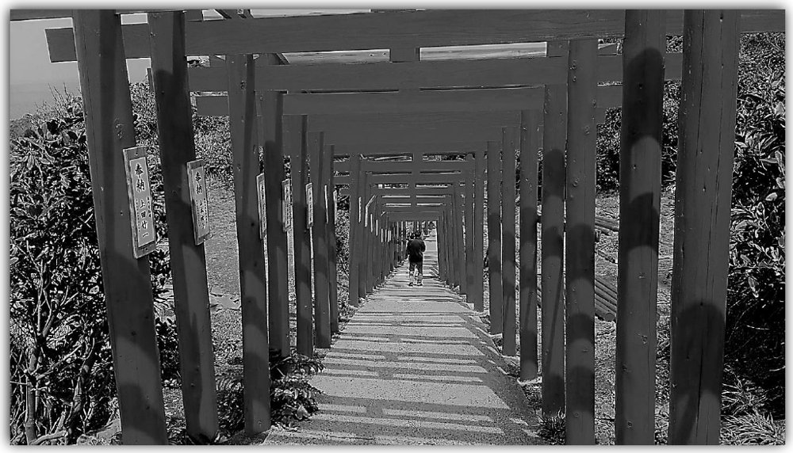

ПЕРЕРОЖДЕНИЕ ИЗУМРУДНОГО ЛАМЫ

Приключение для сеттинга <em>Secrets of Japan</em>

Автор — Жан-Мишель Абрассар

*На обложке — чёрно-белое фото тоннеля из деревянных ворот тории, уходящего вдаль; на дорожке — одинокая фигура человека. Ниже — логотип «Call of Cthulhu — Miskatonic Repository». Английское название: «The Transmigration of the Emerald Lama. An Adventure for the Secrets of Japan setting», автор — Jean-Michel Abrassart.*
