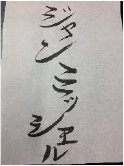

# Выходные данные

Автор — Жан-Мишель Абрассар (Jean-Michel Abrassart).

**Корректоры:** —

**Тестеры:** Фабрис Брабон, Мюра Бриггс, Бенуа Брошо, Давид Буччелла, Алекс Конинкс, Реми Данос Деплянк, Рафаэль Годсман, Ален Пилетт и Оливье Вербрёг (Fabrice Brabon, Murat Briggs, Benoit Brochot, David Buccella, Alex Coninx, Rémi Danos Deplanque, Raphaël Gothesman, Alain Pilette, Olivier Verbreugh).

**Фотографы:** Жан-Мишель Абрассар и Энди Карлье (Andy Carlier).

## Об авторе

Жан-Мишель Абрассар — бельгиец, его родной язык — французский. Он доктор психологии и написал по-французски несколько книг о парапсихологии. Сейчас преподаёт японский язык в вечерней школе для взрослых.

---

*Call of Cthulhu* («Зов Ктулху») — товарный знак Chaosium Inc., используется с её разрешения по программе OBS Community Content.
Подробнее — на сайте Chaosium: www.chaosium.com
Логотип *Miskatonic Repository* используется по лицензии.
