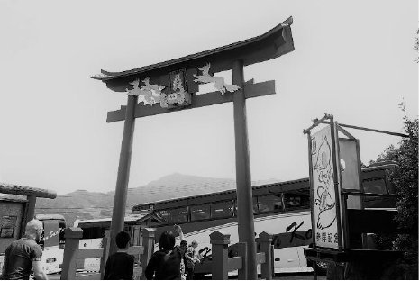

## Сны

Следующей ночью сыщику-полукицунэ начнут сниться странные сны. Они будут повторяться каждую ночь, пока он не вернётся в святилище Мотоносуми Инари, не перейдёт в Страну грёз через тоннель тории и не встретится с Хитоси на той стороне. Сны такие: сыщик видит себя у начала тоннеля из ворот тории. Через несколько секунд сквозь него начинает пробиваться зелёный свет. Открываются врата. Сыщик видит, как переступает порог. Утром у него высасывается ещё немного ВЫН (1d4 за ночь). Если таким образом ВЫН сыщика дойдёт до 0, он умрёт. Это должно подтолкнуть любого упирающегося персонажа вернуться в святилище! Когда сон повторяется, Хранитель может добавить такую подробность: сыщик берёт нож и режет себе запястье перед тоннелем из ворот тории. Это действие и в самом деле нужно, чтобы открыть врата.

## Поиск союзников

Сыщики легко могут поговорить с синтоистским священником или буддийским монахом о том, что случилось с ними в святилище Мотоносуми Инари. Тот знает местную легенду о том, что святилище построено в честь белого лисьего духа. При успешной групповой проверке Удачи он может рассказать и странную историю о человеке, который приходил к нему поговорить лет двадцать назад. Однажды этот человек пошёл на охоту и рыбалку в горы. Он нашёл белую лису, чья лапа попала в капкан. Человек пожалел зверя и освободил его. На следующее утро к его дому пришла красивая молодая женщина, и они полюбили друг друга. После этого необычного случая человек пришёл рассказать о нём синтоистскому священнику или буддийскому монаху. Священник или монах не очень-то поверил этой истории. Но он думает, что если это правда, то существо было кицунэ. Тогда священник или монах посоветовал человеку прогнать женщину. С тех пор он его не видел. Разумеется, этот человек — отец одного из сыщиков. Уйдя от священника или монаха, он не последовал совету и не стал прогонять женщину. Вместо этого они поженились, и у них родился ребёнок.

При подходящих обстоятельствах сыщики могут получить те же сведения прямо от отца сыщика-полукицунэ или даже от своего учителя естествознания Рюити Кимуры, если знают, что тот хорошо разбирается в Мифах, — после того как сыграли сценарий «Мидзууми-но бакэмоно» (сценарий опубликован в 2018 году в *Miskatonic Repository*).

Если сыщики обратятся именно в синтоистское святилище, священник предложит сделать им офуду, то есть талисман. Забрать его можно будет на следующий день.

> **Навык Общение с духами (или рэйкан)**
>
> Сыщик с навыком Общение с духами (подробнее — *Secrets of Japan*, с. 64) может видеть истинный облик кицунэ в человеческом обличье. По-японски этот навык называется «рэйкан». Это как шестое чувство на Западе. Рэйкан — способность ощущать сверхъестественное, особенно призраков. Правило *Secrets of Japan* (с. 229) гласит:
>
> «Люди религиозного склада — синтоистские священники, ямабуси, мико и итако — не видят иллюзий кицунэ, а видят их истинный чуждый облик. Такие святые люди могут смутить кицунэ, сбив ему сосредоточение и разрушив его иллюзорные уловки».
>
> Это чересчур сильно! Вместо этого мы предлагаем такое правило: встретив кицунэ в обличье (например, в человеческом облике), сыщик с навыком Общение с духами может пройти проверку этого навыка. Если проверка удалась, сыщик может мельком увидеть облик ёкая. То есть вместо человека сыщик на миг видит кицунэ. Вопреки сказанному в *Secrets of Japan*, он не видит истинного чуждого облика этих существ.
>
> Ещё одно новое правило, которое мы предлагаем: сыщик с навыком Общение с духами может с помощью игры коккури связаться с духом кицунэ, тануки или другого ёкая. Игра коккури очень похожа на доску Уиджа, но позволяет связаться с японским миром волшебных существ, а не с духами мёртвых. Мысль попробовать это может прийти персонажу при успешной проверке Оккультизма. Разумеется, чтобы действительно связаться с духом кицунэ, ему нужно пройти проверку Общения с духами во время игры. При провале коккури либо не сдвинется с места, либо будет двигаться лишь из-за идеомоторного эффекта — и давать неверные ответы.
