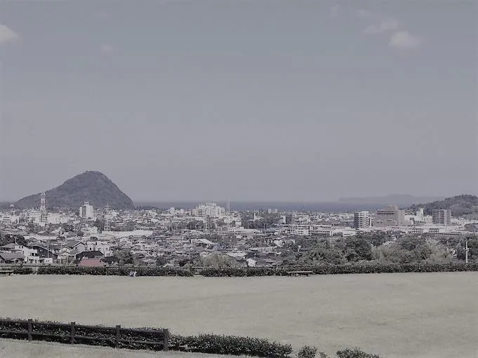

# Приложение 1. Город Хаги

Хаги — туристическое место (в основном для японцев, иностранцев здесь немного) благодаря богатой истории конца периода Эдо и последовавшей за ним эпохи Мэйдзи. Здесь до сих пор есть самурайский квартал, который могут посетить туристы, с множеством старых домов. Был и замок, но его разрушили в эпоху Мэйдзи. Сейчас на его месте лишь парк, а само здание — руины. Ближайший крупный город — Ямагути, столица префектуры. Хаги особенно славится в Японии своей керамикой — хагияки. Здешнее лакомство — микан, разновидность мандарина. К северо-западу от города — Японское море. Там есть пляж, гавань и морской рынок. К югу — горы, зимой покрытые снегом. Есть в Хаги и река Абугава.

Отток в большие города сказался и здесь: большинство подростков мечтают жить в крупных городах вроде Осаки и Токио. Не помогает и то, что город стоит на побережье Японского моря, а синкансэн (скоростной поезд) до него не доходит. Работы сейчас мало. Из-за этого в сельской местности остаётся всё меньше молодёжи… Городу живётся чуть лучше, чем другим, потому что он туристический, — но ненамного.

Название старшей школы, где учатся сыщики, происходит от имени Ёсиды Сёина — известного мыслителя (1830–1859) конца сёгуната Токугава. В то время у него в городе была маленькая школа, а сегодня там святилище, которое могут посетить туристы.

### Места Мифов в округе

- **Плотина на Абугаве**

На реке Абугава в горах построили плотину. В озере за ней живёт община капп. Эти ёкаи — человекоподобные черепахи, любящие есть людей. Этот вид чудовищ — дальний родственник глубоководных. Подробнее — сценарий «Мидзууми-но бакэмоно» Жан-Мишеля Абрассара (опубликован в 2018 году) в *Miskatonic Repository*.

- **Святилище Мотоносуми Инари в Нагато**

Местная легенда гласит, что святилище Мотоносуми Инари построено в честь белого лисьего духа (кицунэ). В нём есть тоннель из 123 красных ворот тории, ведущий к Японскому морю. С помощью нужного магического ритуала через этот тоннель можно попасть в Страну грёз. Нагато — городок в 20 километрах к западу от Хаги. Поездом из Хаги в Нагато вдоль побережья — около часа.

### Некоторые важные персонажи Хранителя

- *Рюити Кимура* (учитель естествознания). Член Агентства «Третий глаз» — организации, которая борется с Мифами в Японии (подробнее — *Secrets of Japan*, с. 197–199).
