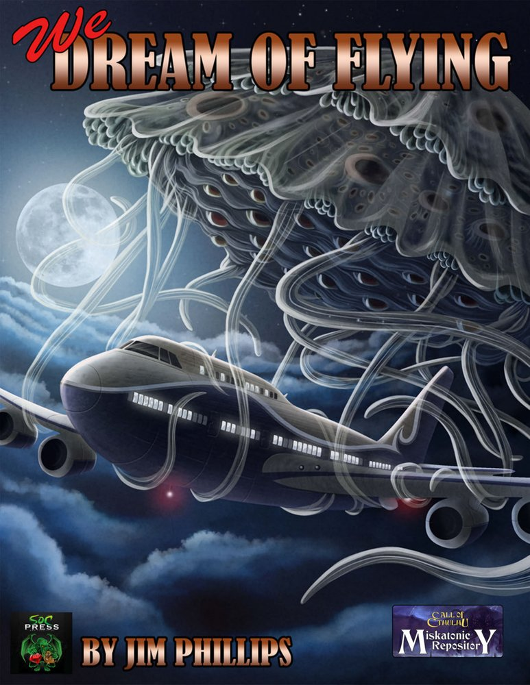

МЫ ГРЕЗИМ О ПОЛЁТЕ

Джим Филлипс

*На обложке — исполинское существо, похожее на медузу, обвивает щупальцами пассажирский «Боинг-747» и несёт его над облаками к полной Луне; вверху — название «We Dream of Flying», внизу — логотип SoC Press, имя автора («By Jim Phillips») и логотип «Call of Cthulhu — Miskatonic Repository».*
