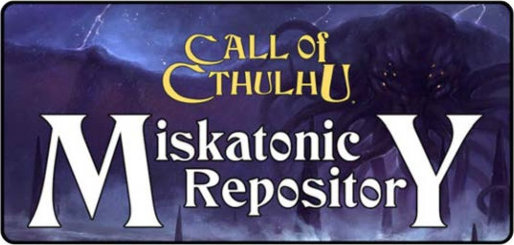

# Выходные данные

Сценарий для «Зова Ктулху» 7-й редакции. Автор — Джим Филлипс (Jim Phillips).

Обложка и иллюстрации — Тобиас Уайт (Tobias White), tobiasartwork.blogspot.com

Карты — Артур (Arthur, Elven Tower Adventures), www.patreon.com/elventower

Особая благодарность всем, кто когда-либо участвовал в Skype of Cthulhu.

www.cthulhu.me

---

*Call of Cthulhu* («Зов Ктулху») — товарный знак Chaosium Inc., используется с её разрешения по программе OBS Community Content.
Подробнее — на сайте Chaosium: www.chaosium.com
Логотип *Miskatonic Repository* используется по лицензии.

«Мы грезим о полёте» (We Dream of Flying) © 2023 Джим Филлипс (Jim Phillips)
