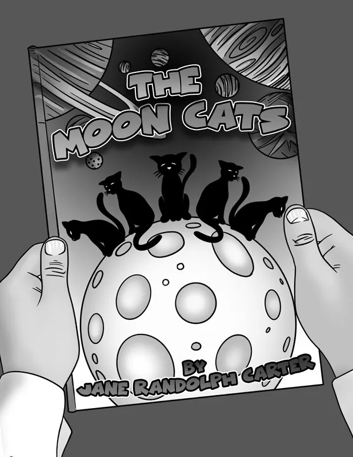

Пока здесь ничего особенного делать или смотреть не нужно. Хранителю стоит дать сыщикам время представиться друг другу, как им захочется, и поболтать о пустяках, стоя в очереди на посадку. Если нужно, в зависимости от группы, не стесняйтесь задавать сыщикам уместные вопросы и по-настоящему раскройте здесь отыгрыш и отношения между персонажами. Если нужно или если кажется интересным, Хранитель может добавить обычные для терминала аэропорта происшествия, чтобы у игроков было больше поводов отыграть своих сыщиков. Например:

- задержка посадки: сыщики стоят в очереди ещё 20 минут, пока решают какую-то неполадку с самолётом;
- пассажир, который сидит в другом салоне, пытается пролезть в группу посадки первого класса;
- путаница с местами, из-за которой некоторым сыщикам приходится пересесть (хотя в итоге каждый сыщик должен оказаться на одном из мест, перечисленных ниже).

*На рисунке — детские руки держат книжку «The Moon Cats» («Лунные коты»): на обложке чёрные кошки на Луне, внизу — «by Jane Randolph Carter».*

Когда объявляют предварительную посадку, сыщики могут пройти проверку **Внимания**. При **обычном** успехе сыщик замечает, что среди пассажиров предварительной посадки — маленькая девочка, Юу, которая летит одна. У неё рюкзак (в нём — Кристаллизатор снов), а к груди она крепко прижимает детскую книжку. При **трудном** успехе сыщик вдобавок замечает, что глаза у Юу красные и опухшие, будто она недавно плакала. А при **чрезвычайном** успехе сыщик может разглядеть название книжки Юу — «Лунные коты» Джейн Р. Картер. Если у сыщика нет своих детей, вряд ли он слышал об этой книжке; впрочем, быстрый поиск в интернете даст сыщику **раздатку 4 — «Лунные коты»**.

*Прим. перев.: на рисунке имя автора на обложке — «Jane Randolph Carter», в тексте — «Jane R. Carter».*

Когда предварительная посадка закончится, на борт пригласят пассажиров первого класса, а с ними и сыщиков. Когда они войдут, бортпроводники направят их по лестнице на верхнюю палубу самолёта, к назначенным местам. Теперь сыщикам можно выдать **раздатку 1 — рейс 19** и **раздатку 2 — первый класс**. Обязательно назовите номер места каждого сыщика; это должно быть одно из следующих мест: 2A, 2B, 3C, 3D, 4D, 4C, 5A, 5B, 6D или 6C.

# Обустройство на борту

Поднявшись на борт, сыщики могут устроиться перед долгим полётом в Токио. Это ещё одна возможность для игроков раскрыть и отыграть своих персонажей. Места первого класса — отдельные «капсулы» с ширмой, отделяющей от соседей, креслами, которые раскладываются в полностью плоскую постель, и большим экраном с обширной библиотекой развлечений на выбор. Когда сыщики усядутся, бортпроводник первого класса предложит каждому что-нибудь выпить и меню ужина. Пусть игроки опишут, как их сыщики готовятся к полёту, устраиваясь в креслах. Некоторые сыщики, возможно, захотят заговорить с соседом — другим сыщиком или персонажем Хранителя. Хранитель тоже может завязать разговор от лица персонажа, чтобы подтолкнуть игроков к отыгрышу.

Пока сыщики ждут, на борт садятся остальные пассажиры. Если кто-то из сыщиков специально прислушивается к объявлениям бортпроводников во время посадки, он услышит, что рейс полностью заполнен и все места заняты. Если никто из сыщиков не следит за объявлениями, то при обычной проверке **Слуха** они заметят это объявление.

Наконец посадка закончена, двери закрываются. Самолёт отталкивают от выхода, он выруливает через лётное поле и взлетает.
