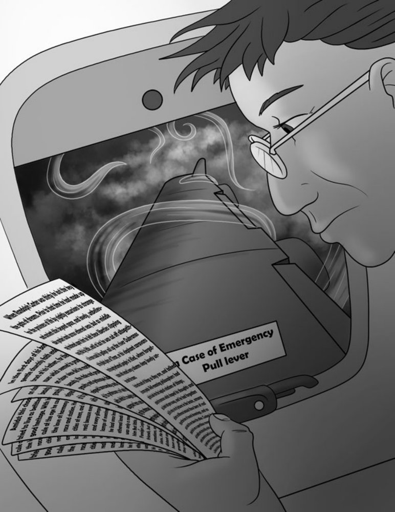

Первый час полёта проходит в суете: в салоне первого класса подают сначала напитки, потом ужин, — но скоро всё стихает: шторки иллюминаторов опущены, пассажиры заняты работой, развлечениями, а большинство просто засыпает. Дайте сыщикам время продолжить или закончить разговоры, если они беседуют, а затем пусть каждый по очереди опишет, как проведёт бо́льшую часть следующих девяти часов на борту до посадки в Токио. Большинство пассажиров — персонажей Хранителя будут спать, хотя по усмотрению Хранителя кто-то из них поговорит с сыщиками, прежде чем заняться своими делами.

Примерно через час каждый сыщик должен либо спать, либо быть занят каким-то своим делом — работой, чтением и т. п.

# Между мирами

Примерно через три часа полёта Юу Накано — без ведома сыщиков — встанет со своего места и уйдёт в самый задний, кормовой туалет главной пассажирской палубы; Кристаллизатор снов она возьмёт с собой, а книжку «Лунные коты» оставит. Сжавшись в своём тесном укрытии, рыдая в одиночестве, Юу своей болью и мукой пробуждает силу Кристаллизатора. Юу отчаянно хочет улететь на Луну и найти Нэко, и это желание заставляет Кристаллизатор призвать Стража, чтобы тот отнёс самолёт на Луну со всеми, кто на борту.

*Прим. перев.: в оригинале — «with Neko and everyone else on board» («с Нэко и всеми остальными на борту»); вероятно, имелась в виду Юу — кот Нэко погиб при пожаре.*

Когда это происходит, мощная сверхъестественная энергия Кристаллизатора вместе со случайно сложившимся из нескольких опытных сновидцев Знаком Старших богов выталкивает и Юу, и сыщиков в промежуточное состояние между миром яви и Страной грёз. Все сыщики, которые в этот момент не спят, проходят проверку **Рассудка** (1d2/1d4): с их точки зрения, все в самолёте, кроме них самих и других сыщиков, внезапно исчезают. Спящие сыщики могут пройти обычную проверку **МОЩ**, чтобы почувствовать неладное и сразу проснуться. Все сыщики, которые проспали переход и проснулись потом — от проверки **МОЩ** или позже, разбуженные другим сыщиком, — проходят проверку **Рассудка** (0/1d2), когда увидят, что самолёт, похоже, пуст.

В любой момент обычная проверка **Сновидения** подскажет сыщику, что он уже не в мире яви, но и не целиком в Стране грёз. Обычная проверка **Тайных знаний (сновидения)** не напомнит сыщику ни одного известного случая, когда сновидец оказывался заперт в таком промежуточном состоянии, а трудная проверка **Тайных знаний (сновидения)** подскажет, что такое состояние возможно, когда группа сновидцев «заряжена» силой — в данном случае тем, что они невольно расположились в виде могущественного магического знака, — и их насильно погружают в сон. Теперь Хранитель может выдать сыщикам **раздатку 3 — Знак Старших богов**.

*На рисунке — пассажир в очках с листами бумаги в руках смотрит в иллюминатор: за стеклом в облаках извиваются полупрозрачные щупальца. На табличке под окном: «In Case of Emergency Pull lever» — «В случае опасности потяните рычаг».*

Все материальные части, которые можно считать частью самолёта, прикреплены они к нему или нет, — кресла, двери, светильники, тележки и тому подобное — существуют физически, и сыщики могут ими пользоваться. Все личные вещи сыщиков — сумки, компьютеры, телефоны и т. п. — тоже здесь, и ими можно пользоваться. Всё остальное — в том числе другие пассажиры и их вещи, еда, вода и т. п. — целиком остаётся в мире яви, а потому сыщикам недоступно и ими не видно.
