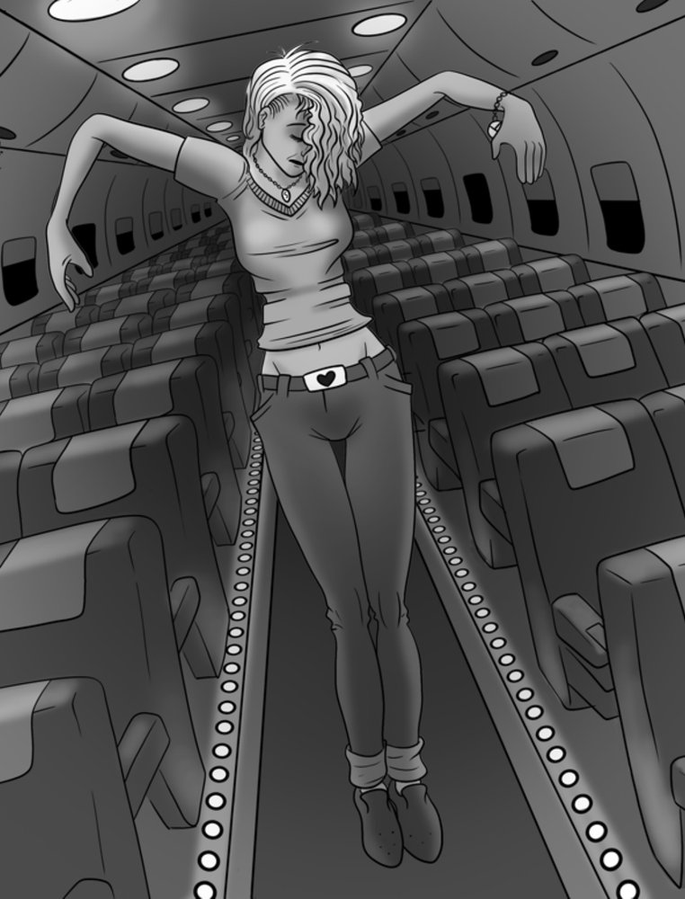

Все остальные сновидцы из первоначальных десяти, кроме сыщиков, погибли от потрясения при переходе. Их тела и вещи находятся и в мире яви, и в состоянии, где оказались сыщики, — так же, как самолёт и его части. Но их разум потерян в бесплотной тьме. Они дышат, кровь их по-прежнему бежит по жилам, но мозг их необратимо мёртв.

Примерно через пятнадцать минут после перехода все сыщики, которые смотрят в иллюминаторы, увидят, как к самолёту сквозь облака приближается Страж (**Рассудок** 1d4/1d6). Страж подлетит к самолёту, обовьёт фюзеляж своими огромными щупальцами (обычная проверка **Слуха** — услышать скрип металла), и самолёт начнёт подниматься (обычная проверка **ИНТ** — распознать, что движение изменилось): Страж понёс его к Луне.

Страж нарочно обращается с самолётом так медленно и бережно, как только может, — он не хочет навредить Юу. Целый час уйдёт у Стража с самолётом на то, чтобы покинуть атмосферу; на Юу и сыщиков это никак не повлияет, но для всех остальных на борту будет означать смерть.

# Тем временем в мире яви

Для тех, кто остался в самолёте в мире яви, пробуждение Кристаллизатора поначалу почти ничем не заметно. Одной маленькой девочки и горстки пассажиров первого класса — сыщиков — больше нет на их местах. Однако уже через десять минут обнаружат мёртвые мозгом, безжизненные тела сновидцев, которые не входят в число сыщиков, и перенесут их с мест в носовой отсек отдыха экипажа на главной пассажирской палубе.

Когда прилетает Страж и начинает нести самолёт к Луне, настроение на борту меняется. Пассажиры и экипаж в мире яви не видят Стража, но, когда самолёт начинает подниматься, а пилоты теряют управление, их охватывает паника. Хранитель может давать сыщикам проверки **Слуха** или **Идеи**, чтобы заметить, как изменился звук двигателей, или вибрацию самолёта, когда пилоты пытаются — тщетно — заставить его снижаться.

Когда что-то, что существует и в мире яви, и в потустороннем состоянии, где находятся сыщики, сдвигают с места, те, кто по другую сторону, видят, как предмет (или тело!) движется будто сам по себе. Например, если пассажир в мире яви войдёт в туалет, любой сыщик, которому видна дверь, увидит, как она открывается, закрывается и запирается — по всей видимости, без чьего-либо участия. Каждый сыщик, увидевший нечто подобное — будь то дверь туалета, тележка бортпроводника или даже поднимающийся или опускающийся откидной столик кресла, — проходит проверку **Рассудка** (0/1d2). Каждый сыщик, который случайно увидит, как переносят тела других сновидцев, тоже проходит проверку **Рассудка** (1/1d4).

*На рисунке — тело девушки с закрытыми глазами парит в проходе пустого салона между рядами кресел: его несут невидимые для сыщиков люди из мира яви.*

Если сыщик попытается помешать предмету (или телу), который движется из-за действия в мире яви, ему нужна встречная проверка **СИЛ**. Обычно Хранитель может считать СИЛ противника равной 50, но это полностью на его усмотрение.

Вмешательство сыщиков, как и любые другие их действия, разумеется, тоже замечают пассажиры и экипаж, оставшиеся в мире яви. Эти действия вместе с общей бедой — Страж поднимает самолёт всё выше — вызывают среди пассажиров растущую панику.
