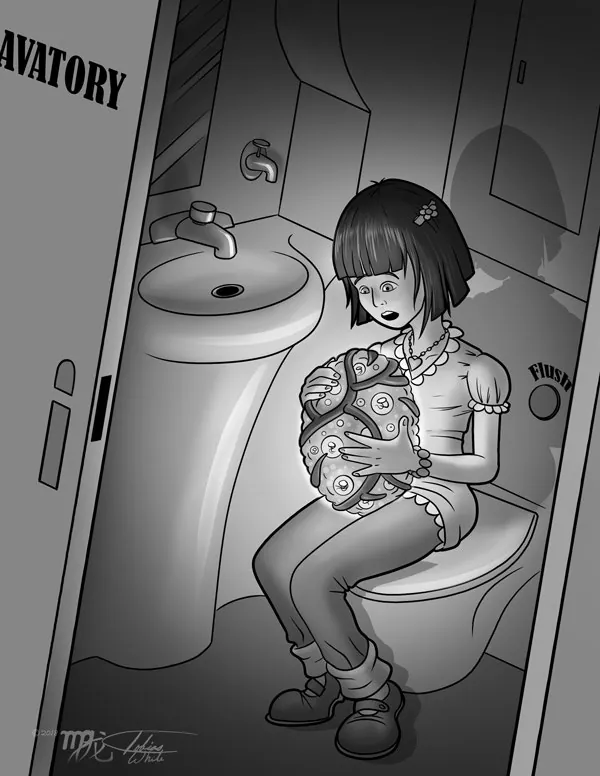

Добравшись до кормового туалета пассажирской палубы, сыщики при обычной проверке **Слуха** услышат тихие, детские всхлипы из одного из кормовых туалетов. Дверь заперта. Сыщики могут поговорить с Юу, и она ответит на их вопросы, как сумеет.

При обычной проверке **Обаяния** или обычной проверке **Убеждения** Юу откроет дверь. Если же сыщики решат выломать дверь, это так напугает Юу, что понадобится трудная проверка **Обаяния** или обычная проверка **Психоанализа**, чтобы успокоить её настолько, чтобы с ней можно было разговаривать дальше. По решению Хранителя она может даже убежать и снова попытаться спрятаться от сыщиков.



*На рисунке — Юу сидит в тесном туалете самолёта (на двери — «Lavatory», «Туалет»; на кнопке — «Flush», «Смыв») и прижимает к себе светящееся, оплетённое щупальцами «яйцо» — Кристаллизатор снов.*

## Юу Накано

```stat
СИЛ 35    ВЫН 50    ТЕЛ 40    ЛВК 50    ИНТ 55
НАР 65    МОЩ 45    ОБР 35    Рассудок 45    ПЗ 9
БкУ: −1   Комплекция: −1   СКО: 8   ПМ: 9   Удача: нет

Броня: нет.
Навыки: Тайные знания (кошки) 30%, Уход за кошками 50%, Обаяние 60%, Иностранный язык (английский) 35%, Иностранный язык (японский) 35%, Естествознание 20%, Скрытность 50%.
```

# Страж

Подробнее о Страже Кристаллизатора снов — в книге Chaosium *Malleus Monstrorum*. Страж в этом сценарии вырос до чудовищных размеров, чтобы нести самолёт, и думает только о том, чтобы отнести Юу (и самолёт) на Луну. Когда эта первоначальная цель достигнута или потеряла смысл, Страж по решению Хранителя может вернуться к своему обычному размеру, прежде чем попытаться забрать Кристаллизатор, и, возможно, при этом напасть на сыщиков.

# Завершение

У сценария «Мы грезим о полёте» есть несколько возможных исходов — в зависимости от того, что в конце концов сделают сыщики. Ниже — несколько предложений, которые Хранитель может менять и дополнять по своему усмотрению.

## Развязка: бездействие

Если сыщики ничего не предпримут или хотя бы ничего существенного, Страж донесёт рейс 19 до Луны и оставит его там; дорога до поверхности Луны займёт у Стража около 12 часов. Все пассажиры в мире яви, разумеется, к тому времени давно погибнут. Опустив самолёт на Луну, Страж разорвёт его своими многочисленными щупальцами, достанет Кристаллизатор снов и унесёт его.

Затем каждый сыщик проходит обычную проверку **Сновидения**. При успехе он целиком переходит в мир сновидений, где его могут ждать новые приключения (например, поиски дороги домой с Луны!). При провале сыщика отбрасывает обратно в мир яви, где он очень быстро задохнётся и замёрзнет насмерть. Сыщик может взять Юу с собой, пройдя ещё одну обычную проверку **Сновидения**.
