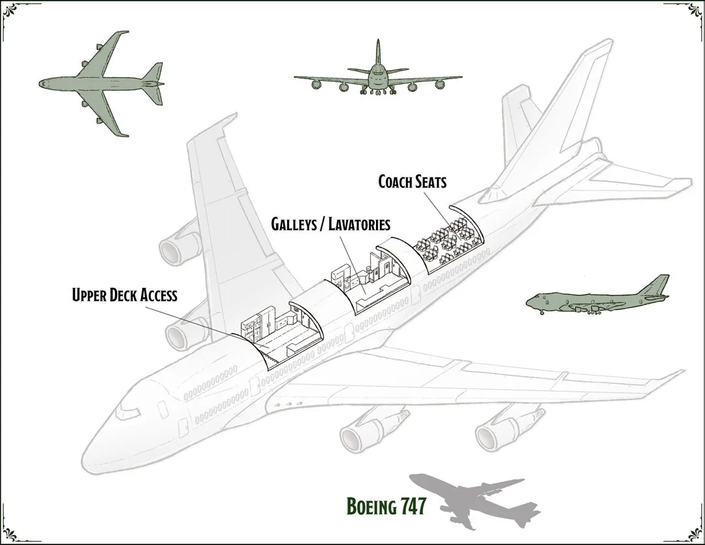

# Раздатка 1 — рейс 19

> **Раздатка 1: рейс 19**
>
> Схема пассажирского «Боинга-747» в разрезе; вокруг — силуэты самолёта сверху, спереди и сбоку.
>
> Подписи на схеме:
>
> - «Upper Deck Access» — «Лестница на верхнюю палубу»
> - «Galleys / Lavatories» — «Кухни / туалеты»
> - «Coach Seats» — «Места эконом-класса»
> - «Boeing 747» — «Боинг-747»
