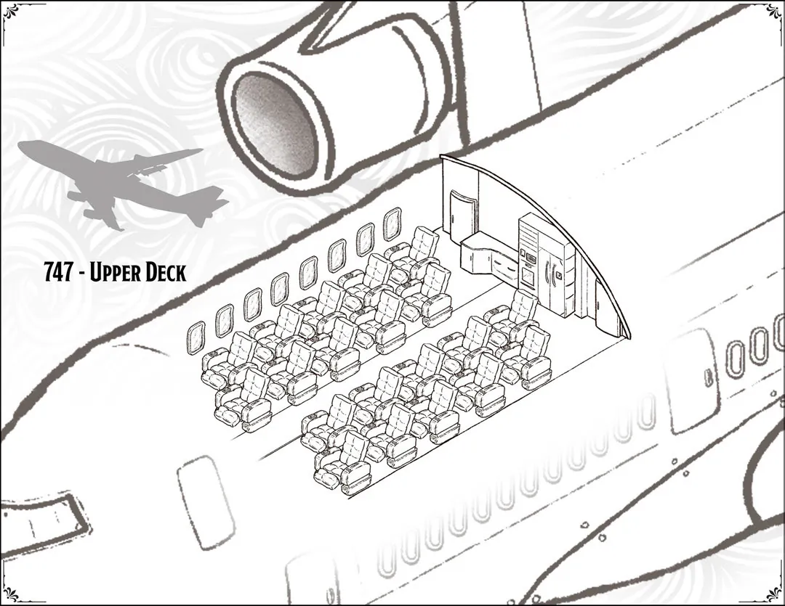

# Раздатка 2 — первый класс

> **Раздатка 2: первый класс**
>
> Салон первого класса на верхней палубе «Боинга-747» в разрезе фюзеляжа: ряды кресел-«капсул». Номеров мест на рисунке нет — Хранитель называет каждому сыщику его место (2A, 2B, 3C, 3D, 4D, 4C, 5A, 5B, 6D или 6C).
>
> Подпись: «747 - Upper Deck» — «Боинг-747 — верхняя палуба».
