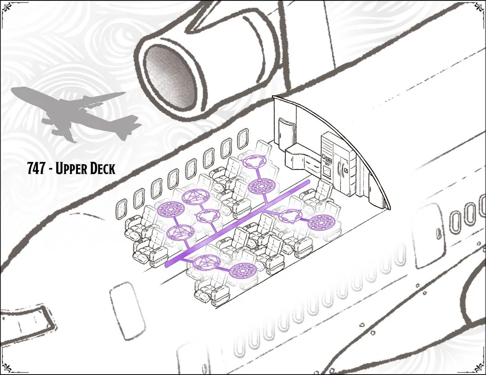

# Раздатка 3 — Знак Старших богов

> **Раздатка 3: Знак Старших богов в первом классе**
>
> Тот же рисунок салона первого класса, что и в раздатке 2, но поверх кресел линиями и кругами нарисован Знак Старших богов: десять мест сновидцев образуют его узор.
>
> Подпись: «747 - Upper Deck» — «Боинг-747 — верхняя палуба».
