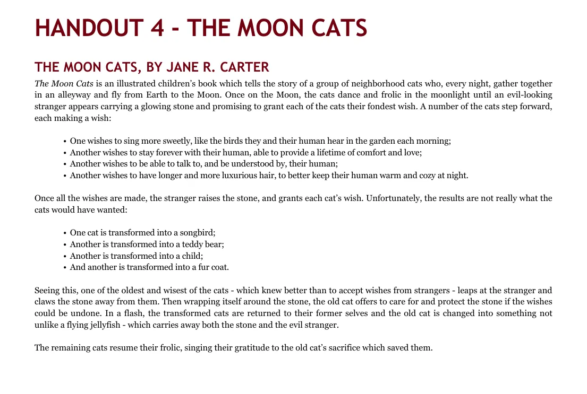

# Раздатка 4 — «Лунные коты»

> **Раздатка 4: «Лунные коты»**
>
> **«ЛУННЫЕ КОТЫ» ДЖЕЙН Р. КАРТЕР**
>
> «Лунные коты» — иллюстрированная детская книжка о соседских кошках, которые каждую ночь собираются в переулке и улетают с Земли на Луну. На Луне кошки танцуют и резвятся в лунном свете, пока не появляется зловещего вида незнакомец со светящимся камнем и не обещает исполнить самое заветное желание каждой. Несколько кошек выходят вперёд, и каждая загадывает желание:
>
> - одна хочет петь слаще, как птицы, которых она и её хозяин слышат каждое утро в саду;
> - другая — навсегда остаться со своим хозяином и всю жизнь дарить ему уют и любовь;
> - третья — разговаривать со своим хозяином и чтобы он её понимал;
> - ещё одна — отрастить шерсть длиннее и пышнее, чтобы лучше согревать хозяина по ночам.
>
> Когда все желания загаданы, незнакомец поднимает камень и исполняет желание каждой кошки. К несчастью, выходит совсем не то, чего хотели кошки:
>
> - одна кошка превращается в певчую птицу;
> - другая — в плюшевого мишку;
> - третья — в ребёнка;
> - а ещё одна — в меховую шубу.
>
> Увидев это, одна из самых старых и мудрых кошек, которая знала, что нельзя принимать желания от незнакомцев, бросается на незнакомца и когтями выбивает у него камень. Обвившись вокруг камня, старая кошка предлагает беречь и охранять его, если желания можно отменить. В тот же миг превращённые кошки снова становятся собой, а старая кошка превращается во что-то вроде летающей медузы — и уносит прочь и камень, и злого незнакомца.
>
> Остальные кошки снова резвятся и поют, благодаря старую кошку за жертву, которая их спасла.
