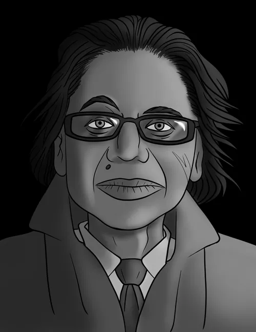

# Раджив Пелагия (they / them)

## Руководитель разработки ПО в технологической компании среднего размера

Раджив Пелагия — главный инженер успешной технологической компании среднего размера в Лос-Анджелесе; живёт там с партнёром и тремя детьми. Карьера Раджива началась сразу после университета с должности младшего инженера, и с тех пор вся энергия уходит на восхождение по служебной лестнице. Цель Раджива — должность не ниже вице-президента, а то и выше, и добраться до неё хочется скорее раньше, чем позже.

В университетские годы каждое лето Раджива проходило в Индии, в учении у одного определённого йога. Там Раджив обрёл сосредоточенность и самообладание, нужные для успеха в профессиональной жизни. Йог водил Раджива и в путешествия по Стране грёз, и, хотя Радживу довелось увидеть много странного и чудесного и услышать много необычных историй, становиться сновидцем всерьёз Радживу никогда не казалось стоящим делом.

Именно во время этих путешествий в Страну грёз Раджив научился заклинанию «Песнь Тота» (см. «Книгу хранителя» 7-й редакции).

Сейчас Раджив летит первым классом в Токио с пересадкой на Нью-Дели. С Радживом летит младший инженер из той же компании, Джульетта Ульяна, — разумеется, Джульетта сидит в эконом-классе.

*Прим. перев.: в заголовке биографии должность — «Software Manager» (руководитель разработки ПО), а в тексте и на листе сыщика — «Chief Engineer» (главный инженер).*

Раджив знаком с Дарио Мадхави: недавно Дарио проводил однодневный корпоративный выездной семинар для руководства компании Раджива.

# Леони Кай (they / them)

## Старший советник по торговым и дипломатическим связям в Центральной Азии

Леони Кай родом из одной из многих небольших республик Центральной Азии; в Соединённые Штаты Леони приехали учиться в университете — изучать международные деловые отношения. Вскоре после выпуска Леони получили работу в нефтяном конгломерате и быстро поднялись по служебной лестнице до нынешней должности — старшего советника совета директоров по вопросам торговых и дипломатических связей в Центральной Азии и вокруг неё. Леони спокойны, собранны, рассудительны и почти всю жизнь проводят в разъездах, хотя у них есть небольшая квартира в Лос-Анджелесе, где Леони живут одни.

В маленьком селении, где выросли Леони, сохраняется очень традиционный уклад жизни, и именно у местного шамана Леони впервые научились видеть сны. Леони очень быстро стали умелым сновидцем, и многочисленные странствия по Стране грёз пробудили в Леони желание покинуть селение и искать свой путь в большом мире.

У того же шамана Леони научились и заклинанию «Околдовать жертву» (см. «Книгу хранителя» 7-й редакции) — умению, которое сослужило им хорошую службу в карьере.

Сейчас Леони летят первым классом в Токио на азиатский торговый саммит, а оттуда — в Тбилиси, чтобы попытаться довести до конца сделку об открытии новых газовых месторождений для разведки. С Леони летит их помощник Марцели Неда, хотя Марцели летит эконом-классом.

Леони знакомы с Михалом Правином: оба последние несколько лет бывали на разных торговых конференциях и переговорах.
