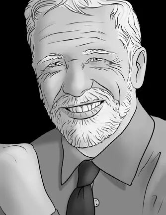
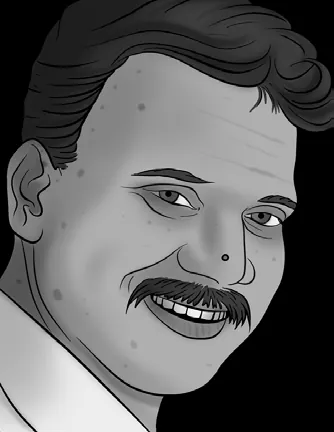

# Михал Правин (he / him)

## Первый секретарь по консульским делам посольства США в Японии

Михал Правин родился и вырос в Нью-Йорке, недалеко от ООН. Сын переводчика ООН, Михал с юных лет соприкасался с миром международной дипломатии. Его завораживало взаимодействие культур, идей и народов, которые постоянно приходили и уходили, и он точно знал, каким путём хочет пойти по жизни. Изучив политологию в университете, Михал поступил в Государственный департамент США и со временем дослужился до нынешней должности — первого секретаря по консульским делам посольства США в Японии.

Михал женат на японке, у них двое детей. Семья живёт в Токио, и, хотя Михал часто летает в США, обычно он путешествует один. Михал много лет жил и работал по всему миру, у него была возможность встречаться и учиться у многих мудрецов и религиозных деятелей, и именно от них Михал впервые увидел Страну грёз. Опытным сновидцем Михал не стал, хотя его увлекают разные народы и культуры, живущие в Стране грёз.

Где-то по пути — Михал уже не помнит точно, где и когда, — он научился заклинанию «Затуманить память» (см. «Книгу хранителя» 7-й редакции).

Сейчас Михал летит первым классом из Лос-Анджелеса в Токио после короткого дипломатического саммита в Лос-Анджелесе. С ним летит один из младших помощников посольства, Маршалл Илеан, хотя Маршалл сидит в эконом-классе.

Михал мельком знаком с Леони Кай: оба последние несколько лет бывали на разных торговых конференциях и переговорах.

# Дарио Мадхави (he / him)

## Мотивационный оратор и автор серии книг по самопомощи

Дарио Мадхави — уроженец Мумбаи; он родился в семье очень успешных и известных йогов. Ещё маленьким ребёнком Дарио видел, как люди со всего мира приезжают в Мумбаи навестить разных членов его большой семьи и поучиться у них, и никогда не было сомнений, что Дарио пойдёт по их стопам.

Повзрослев, Дарио стал йогом сам и быстро обрёл популярность — у него появились верные, хоть и немногочисленные последователи. Дарио начал издавать серию книг по своим учениям, и её популярность по всему миру неуклонно растёт. Теперь Дарио целыми днями летает по миру и проводит мотивационные семинары, на которые всегда собирается много людей.

Как традиционный йог, Дарио ещё и очень опытный сновидец. Он часто бывает в Стране грёз и водит туда некоторых клиентов — тех, кто может оплатить его высокие гонорары. Дарио искусно владеет заклинанием «Слова власти» (см. «Книгу хранителя» 7-й редакции) — умением, которое, несомненно, хотя бы отчасти объясняет его успех.

Сейчас Дарио летит первым классом в Токио на очередной семинар, только что завершив очень успешный тур по Калифорнии. С ним летит его личный помощник Альбина Фернанде, хотя Альбина, разумеется, сидит в эконом-классе.

Дарио знаком с Радживом Пелагией: недавно Дарио проводил однодневный корпоративный выездной семинар для руководства компании Раджива.
