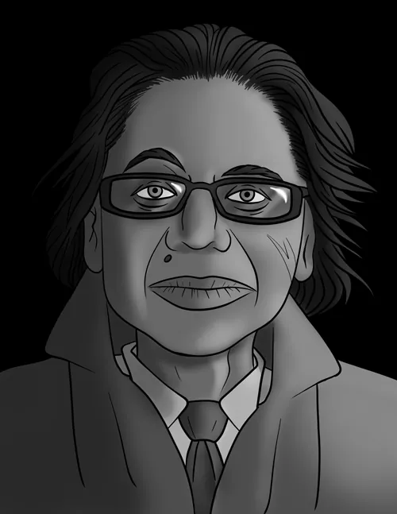

# Лист сыщика: Раджив Пелагия

*Лист сыщика наших дней (Modern Era Investigator) с портретом; ниже — его данные переводом.*

| Поле листа | Значение |
|---|---|
| Имя | Раджив Пелагия (Rajeev Pelagia) |
| Профессия | главный инженер («Chief Engineer») |
| Возраст | 36 |
| Место жительства | Лос-Анджелес |
| Место рождения | Лос-Анджелес |

**Характеристики**

| СИЛ | ВЫН | ТЕЛ | ЛВК | НАР | ОБР | ИНТ | МОЩ |
|---|---|---|---|---|---|---|---|
| 50 (25/10) | 50 (25/10) | 60 (30/12) | 40 (20/8) | 50 (25/10) | 80 (40/16) | 70 (35/14) | 60 (30/12) |

| ПЗ | Рассудок | Удача | ПМ | СКО | БкУ | Комплекция | Уклонение |
|---|---|---|---|---|---|---|---|
| 11 | 60 (макс. 89) | 60 | 12 | 7 | нет | 0 | 20% (10/4) |

**Навыки** (значение, половина / пятая доля)

| Навык | Значение |
|---|---|
| Бухгалтерское дело | 50% (25/10) |
| Запугивание | 40% (20/8) |
| Иностранный язык (хинди) | 30% (15/6) |
| Механика | 40% (20/8) |
| Мифы Ктулху | 10% (5/2) |
| Наука (математика) | 50% (25/10) |
| Оккультизм | 25% (12/5) |
| Психология | 30% (15/6) |
| Работа в библиотеке | 40% (20/8) |
| Работа с компьютером | 70% (35/14) |
| Родной язык (английский) | 80% (40/16) |
| Сновидение | 20% (10/4) |
| Средства | 50% (25/10) |
| Тайные знания (сновидения) | 40% (20/8) |
| Убеждение | 30% (15/6) |
| Электрика | 60% (30/12) |
| Электроника | 60% (30/12) |

**Оружие**

| Оружие | Навык | Шанс | Урон | Атак |
|---|---|---|---|---|
| Без оружия | Ближний бой (драка) | — | 1d3+БкУ | 1 |

*Прим. перев.: на листе строка «Unarmed» без процентов, навык Ближний бой (драка) не заполнен (базовое значение навыка — 25%).*

**Заклинание** (из биографии): Песнь Тота (см. «Книгу хранителя» 7-й редакции).

**Предыстория**

На листе предыстория не заполнена; биография — на с. 14. Коротко: Главный инженер успешной технологической компании среднего размера в Лос-Анджелесе; живёт с партнёром и тремя детьми. Местоимения в книге — they/them. В заголовке биографии — «руководитель разработки ПО в технологической компании среднего размера», в тексте и на листе — главный инженер (Chief Engineer). Летит первым классом в Токио с пересадкой на Нью-Дели; место — одно из десяти мест Знака Старших богов на верхней палубе.
