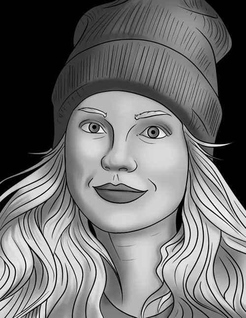

# Лист сыщика: Сильвиана Радомил

*Лист сыщика наших дней (Modern Era Investigator) с портретом; ниже — его данные переводом.*

| Поле листа | Значение |
|---|---|
| Имя | Сильвиана Радомил (Sylviane Radomil) |
| Профессия | певица / актриса («Singer / Actress») |
| Возраст | 19 |
| Место жительства | Прага, Чехия |
| Место рождения | Прага, Чехия |

**Характеристики**

| СИЛ | ВЫН | ТЕЛ | ЛВК | НАР | ОБР | ИНТ | МОЩ |
|---|---|---|---|---|---|---|---|
| 50 (25/10) | 70 (35/14) | 40 (20/8) | 60 (30/12) | 80 (40/16) | 50 (25/10) | 50 (25/10) | 60 (30/12) |

| ПЗ | Рассудок | Удача | ПМ | СКО | БкУ | Комплекция | Уклонение |
|---|---|---|---|---|---|---|---|
| 11 | 60 (макс. 89) | 50 | 12 | 9 | нет | 0 | 30% (15/6) |

**Навыки** (значение, половина / пятая доля)

| Навык | Значение |
|---|---|
| Иностранный язык (английский) | 40% (20/8) |
| Искусство/ремесло (актёрская игра) | 60% (30/12) |
| Искусство/ремесло (пение) | 70% (35/14) |
| Ловкость рук | 40% (20/8) |
| Маскировка | 35% (17/7) |
| Мифы Ктулху | 10% (5/2) |
| Обаяние | 60% (30/12) |
| Оккультизм | 40% (20/8) |
| Прыжки | 25% (12/5) |
| Психоанализ | 30% (15/6) |
| Психология | 50% (25/10) |
| Родной язык (чешский) | 50% (25/10) |
| Слух | 40% (20/8) |
| Сновидение | 15% (7/3) |
| Средства | 40% (20/8) |
| Тайные знания (сновидения) | 10% (5/2) |

**Оружие**

| Оружие | Навык | Шанс | Урон | Атак |
|---|---|---|---|---|
| Без оружия | Ближний бой (драка) | — | 1d3+БкУ | 1 |

*Прим. перев.: на листе строка «Unarmed» без процентов, навык Ближний бой (драка) не заполнен (базовое значение навыка — 25%).*

**Заклинание** (из биографии): Метаморфозы Горгорота (см. «Книгу хранителя» 7-й редакции).

**Предыстория**

На листе предыстория не заполнена; биография — на с. 15. Коротко: Молодая поп-певица из Праги (на листе — певица и актриса, 19 лет); с умеренным успехом выступает по Восточной Европе и мечтает об актёрской карьере.
