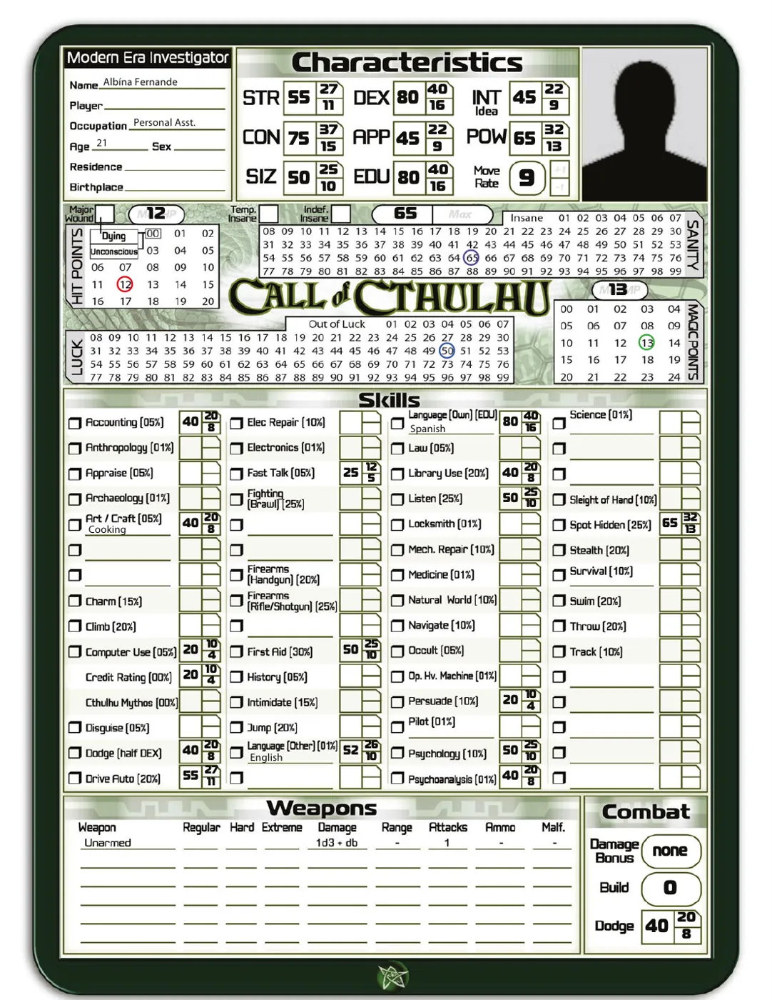

# Лист спутника: Альбина Фернанде

*Лист сыщика наших дней (Modern Era Investigator); вместо портрета — силуэт. Ниже — данные листа переводом.*

| Поле листа | Значение |
|---|---|
| Имя | Альбина Фернанде (Albína Fernande) |
| Профессия | личный помощник («Personal Asst.») |
| Возраст | 21 |
| Место жительства | — |
| Место рождения | — |

**Характеристики**

| СИЛ | ВЫН | ТЕЛ | ЛВК | НАР | ОБР | ИНТ | МОЩ |
|---|---|---|---|---|---|---|---|
| 55 (27/11) | 75 (37/15) | 50 (25/10) | 80 (40/16) | 45 (22/9) | 80 (40/16) | 45 (22/9) | 65 (32/13) |

| ПЗ | Рассудок | Удача | ПМ | СКО | БкУ | Комплекция | Уклонение |
|---|---|---|---|---|---|---|---|
| 12 | 65 (макс. на листе не указан) | 50 | 13 | 9 | нет | 0 | 40% (20/8) |

**Навыки** (значение, половина / пятая доля)

| Навык | Значение |
|---|---|
| Бухгалтерское дело | 40% (20/8) |
| Внимание | 65% (32/13) |
| Вождение автомобиля | 55% (27/11) |
| Иностранный язык (английский) | 52% (26/10) |
| Искусство/ремесло (кулинария) | 40% (20/8) |
| Красноречие | 25% (12/5) |
| Первая помощь | 50% (25/10) |
| Психоанализ | 40% (20/8) |
| Психология | 50% (25/10) |
| Работа в библиотеке | 40% (20/8) |
| Работа с компьютером | 20% (10/4) |
| Родной язык (испанский) | 80% (40/16) |
| Слух | 50% (25/10) |
| Средства | 20% (10/4) |
| Убеждение | 20% (10/4) |

**Оружие**

| Оружие | Навык | Шанс | Урон | Атак |
|---|---|---|---|---|
| Без оружия | Ближний бой (драка) | — | 1d3+БкУ | 1 |

*Прим. перев.: на листе строка «Unarmed» без процентов, навык Ближний бой (драка) не заполнен (базовое значение навыка — 25%).*

**Предыстория**

На листе предыстория не заполнена, биографии в книге нет: спутник летит эконом-классом вместе с Дарио Мадхави (с. 23). В сценарии остаётся в мире яви, на главной палубе среди пассажиров; сыщик может связаться со своим спутником (раздел «С другой стороны», с. 7).
