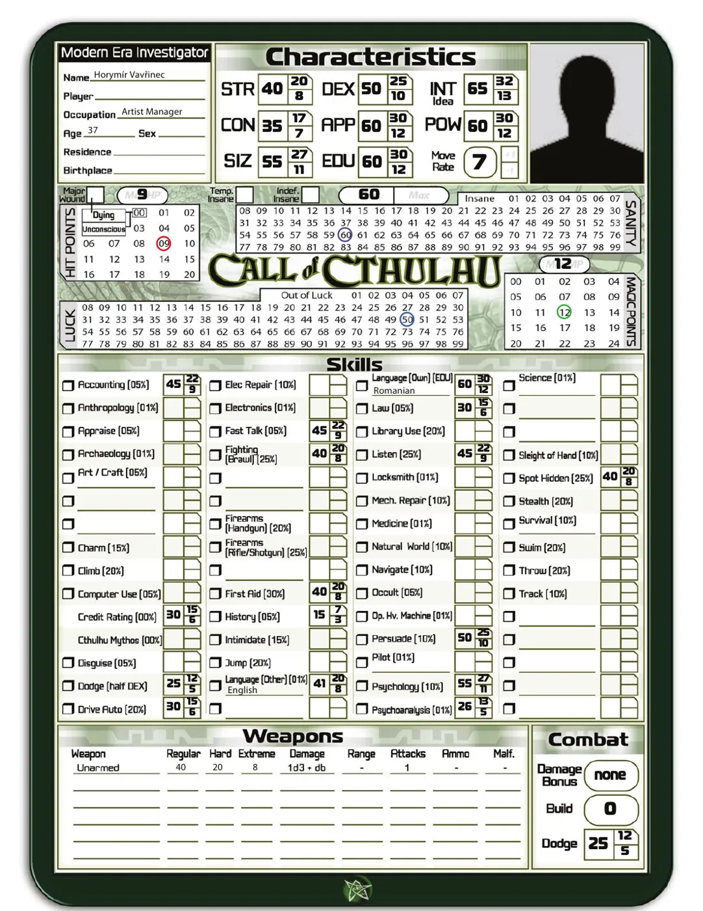

# Лист спутника: Горимир Вавржинец

*Лист сыщика наших дней (Modern Era Investigator); вместо портрета — силуэт. Ниже — данные листа переводом.*

| Поле листа | Значение |
|---|---|
| Имя | Горимир Вавржинец (Horymír Vavřinec) |
| Профессия | менеджер артиста («Artist Manager») |
| Возраст | 37 |
| Место жительства | — |
| Место рождения | — |

**Характеристики**

| СИЛ | ВЫН | ТЕЛ | ЛВК | НАР | ОБР | ИНТ | МОЩ |
|---|---|---|---|---|---|---|---|
| 40 (20/8) | 35 (17/7) | 55 (27/11) | 50 (25/10) | 60 (30/12) | 60 (30/12) | 65 (32/13) | 60 (30/12) |

| ПЗ | Рассудок | Удача | ПМ | СКО | БкУ | Комплекция | Уклонение |
|---|---|---|---|---|---|---|---|
| 9 | 60 (макс. на листе не указан) | 50 | 12 | 7 | нет | 0 | 25% (12/5) |

**Навыки** (значение, половина / пятая доля)

| Навык | Значение |
|---|---|
| Ближний бой (драка) | 40% (20/8) |
| Бухгалтерское дело | 45% (22/9) |
| Внимание | 40% (20/8) |
| Вождение автомобиля | 30% (15/6) |
| Иностранный язык (английский) | 41% (20/8) |
| История | 15% (7/3) |
| Красноречие | 45% (22/9) |
| Первая помощь | 40% (20/8) |
| Психоанализ | 26% (13/5) |
| Психология | 55% (27/11) |
| Родной язык (румынский) | 60% (30/12) |
| Слух | 45% (22/9) |
| Средства | 30% (15/6) |
| Убеждение | 50% (25/10) |
| Юриспруденция | 30% (15/6) |

**Оружие**

| Оружие | Навык | Шанс | Урон | Атак |
|---|---|---|---|---|
| Без оружия | Ближний бой (драка) | 40% (20/8) | 1d3+БкУ | 1 |

**Предыстория**

На листе предыстория не заполнена, биографии в книге нет: спутник летит эконом-классом вместе с Сильвианой Радомил (с. 23). В сценарии остаётся в мире яви, на главной палубе среди пассажиров; сыщик может связаться со своим спутником (раздел «С другой стороны», с. 7).
