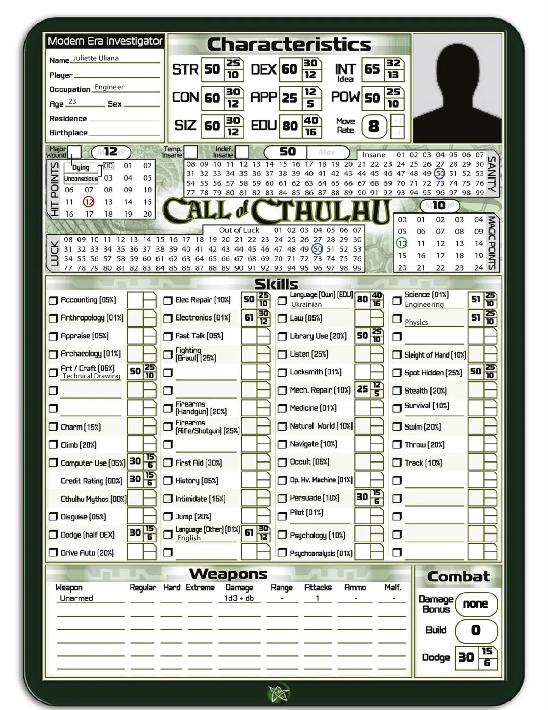

# Лист спутника: Джульетта Ульяна

*Лист сыщика наших дней (Modern Era Investigator); вместо портрета — силуэт. Ниже — данные листа переводом.*

| Поле листа | Значение |
|---|---|
| Имя | Джульетта Ульяна (Juliette Uliana) |
| Профессия | инженер («Engineer») |
| Возраст | 23 |
| Место жительства | — |
| Место рождения | — |

**Характеристики**

| СИЛ | ВЫН | ТЕЛ | ЛВК | НАР | ОБР | ИНТ | МОЩ |
|---|---|---|---|---|---|---|---|
| 50 (25/10) | 60 (30/12) | 60 (30/12) | 60 (30/12) | 25 (12/5) | 80 (40/16) | 65 (32/13) | 50 (25/10) |

| ПЗ | Рассудок | Удача | ПМ | СКО | БкУ | Комплекция | Уклонение |
|---|---|---|---|---|---|---|---|
| 12 | 50 (макс. на листе не указан) | 50 | 10 | 8 | нет | 0 | 30% (15/6) |

**Навыки** (значение, половина / пятая доля)

| Навык | Значение |
|---|---|
| Внимание | 50% (25/10) |
| Иностранный язык (английский) | 61% (30/12) |
| Искусство/ремесло (техническое черчение) | 50% (25/10) |
| Механика | 25% (12/5) |
| Наука (инженерное дело) | 51% (25/10) |
| Наука (физика) | 51% (25/10) |
| Работа в библиотеке | 50% (25/10) |
| Работа с компьютером | 30% (15/6) |
| Родной язык (украинский) | 80% (40/16) |
| Средства | 30% (15/6) |
| Убеждение | 30% (15/6) |
| Электрика | 50% (25/10) |
| Электроника | 61% (30/12) |

**Оружие**

| Оружие | Навык | Шанс | Урон | Атак |
|---|---|---|---|---|
| Без оружия | Ближний бой (драка) | — | 1d3+БкУ | 1 |

*Прим. перев.: на листе строка «Unarmed» без процентов, навык Ближний бой (драка) не заполнен (базовое значение навыка — 25%).*

**Предыстория**

На листе предыстория не заполнена, биографии в книге нет: спутник летит эконом-классом вместе с Радживом Пелагией (с. 23). В сценарии остаётся в мире яви, на главной палубе среди пассажиров; сыщик может связаться со своим спутником (раздел «С другой стороны», с. 7).
