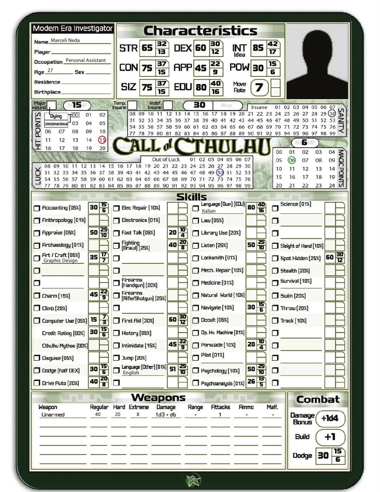

# Лист спутника: Марцели Неда

*Лист сыщика наших дней (Modern Era Investigator); вместо портрета — силуэт. Ниже — данные листа переводом.*

| Поле листа | Значение |
|---|---|
| Имя | Марцели Неда (Marceli Neda) |
| Профессия | личный помощник («Personal Assistant») |
| Возраст | 27 |
| Место жительства | — |
| Место рождения | — |

**Характеристики**

| СИЛ | ВЫН | ТЕЛ | ЛВК | НАР | ОБР | ИНТ | МОЩ |
|---|---|---|---|---|---|---|---|
| 65 (32/13) | 75 (37/15) | 75 (37/15) | 60 (30/12) | 45 (22/9) | 80 (40/16) | 85 (42/17) | 30 (15/6) |

| ПЗ | Рассудок | Удача | ПМ | СКО | БкУ | Комплекция | Уклонение |
|---|---|---|---|---|---|---|---|
| 15 | 30 (макс. на листе не указан) | 50 | 6 | 7 | +1d4 | +1 | 30% (15/6) |

**Навыки** (значение, половина / пятая доля)

| Навык | Значение |
|---|---|
| Ближний бой (драка) | 40% (20/8) |
| Бухгалтерское дело | 30% (15/6) |
| Внимание | 60% (30/12) |
| Вождение автомобиля | 40% (20/8) |
| Запугивание | 45% (22/9) |
| Иностранный язык (английский) | 51% (25/10) |
| Искусство/ремесло (графический дизайн) | 35% (17/7) |
| Красноречие | 20% (10/4) |
| Обаяние | 45% (22/9) |
| Ориентирование | 30% (15/6) |
| Оценка | 50% (25/10) |
| Первая помощь | 60% (30/12) |
| Психоанализ | 26% (13/5) |
| Психология | 50% (25/10) |
| Работа с компьютером | 15% (7/3) |
| Родной язык (итальянский) | 80% (40/16) |
| Слух | 50% (25/10) |
| Средства | 30% (15/6) |
| Убеждение | 20% (10/4) |

**Оружие**

| Оружие | Навык | Шанс | Урон | Атак |
|---|---|---|---|---|
| Без оружия | Ближний бой (драка) | 40% (20/8) | 1d3+БкУ | 1 |

**Предыстория**

На листе предыстория не заполнена, биографии в книге нет: спутник летит эконом-классом вместе с Леони Кай (с. 23). В сценарии остаётся в мире яви, на главной палубе среди пассажиров; сыщик может связаться со своим спутником (раздел «С другой стороны», с. 7).
