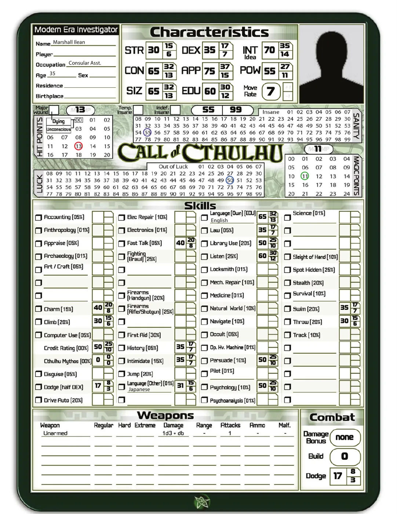

# Лист спутника: Маршалл Илеан

*Лист сыщика наших дней (Modern Era Investigator); вместо портрета — силуэт. Ниже — данные листа переводом.*

| Поле листа | Значение |
|---|---|
| Имя | Маршалл Илеан (Marshall Ilean) |
| Профессия | помощник по консульским делам («Consular Asst.») |
| Возраст | 35 |
| Место жительства | — |
| Место рождения | — |

**Характеристики**

| СИЛ | ВЫН | ТЕЛ | ЛВК | НАР | ОБР | ИНТ | МОЩ |
|---|---|---|---|---|---|---|---|
| 30 (15/6) | 65 (32/13) | 65 (32/13) | 35 (17/7) | 75 (37/15) | 60 (30/12) | 70 (35/14) | 55 (27/11) |

| ПЗ | Рассудок | Удача | ПМ | СКО | БкУ | Комплекция | Уклонение |
|---|---|---|---|---|---|---|---|
| 13 | 55 (макс. 99) | 50 | 11 | 7 | нет | 0 | 17% (8/3) |

**Навыки** (значение, половина / пятая доля)

| Навык | Значение |
|---|---|
| Запугивание | 35% (17/7) |
| Иностранный язык (японский) | 31% (15/6) |
| История | 35% (17/7) |
| Красноречие | 40% (20/8) |
| Лазание | 30% (15/6) |
| Метание | 30% (15/6) |
| Мифы Ктулху | 0% (0/0) |
| Обаяние | 40% (20/8) |
| Плавание | 35% (17/7) |
| Психология | 50% (25/10) |
| Работа в библиотеке | 50% (25/10) |
| Родной язык (английский) | 65% (32/13) |
| Слух | 60% (30/12) |
| Средства | 50% (25/10) |
| Убеждение | 50% (25/10) |
| Юриспруденция | 35% (17/7) |

**Оружие**

| Оружие | Навык | Шанс | Урон | Атак |
|---|---|---|---|---|
| Без оружия | Ближний бой (драка) | — | 1d3+БкУ | 1 |

*Прим. перев.: на листе строка «Unarmed» без процентов, навык Ближний бой (драка) не заполнен (базовое значение навыка — 25%).*

**Предыстория**

На листе предыстория не заполнена, биографии в книге нет: спутник летит эконом-классом вместе с Михалом Правином (с. 23). В сценарии остаётся в мире яви, на главной палубе среди пассажиров; сыщик может связаться со своим спутником (раздел «С другой стороны», с. 7).
