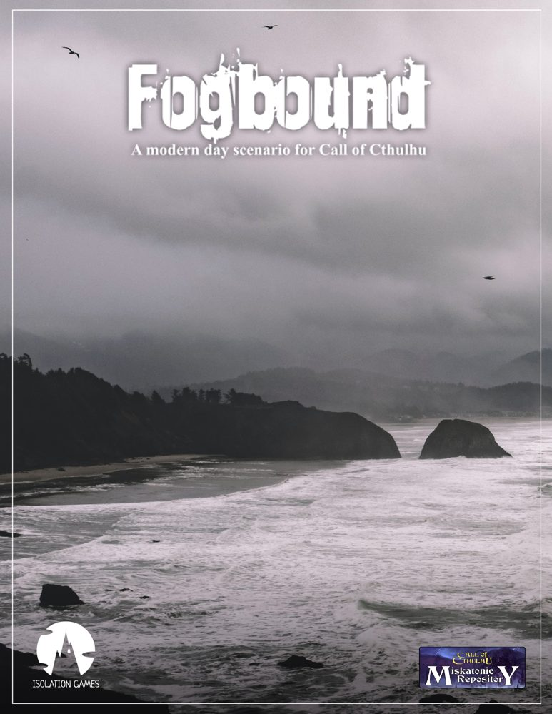

В ПЛЕНУ ТУМАНА

Сценарий для «Зова Ктулху» в наши дни

Роб Ли

*На обложке — затянутое тучами и туманом морское побережье, волны разбиваются у скал; вверху — заголовок «Fogbound» и подзаголовок «A modern day scenario for Call of Cthulhu» («Сценарий для „Зова Ктулху“ в наши дни»), внизу — логотипы Isolation Games и «Call of Cthulhu — Miskatonic Repository».*
