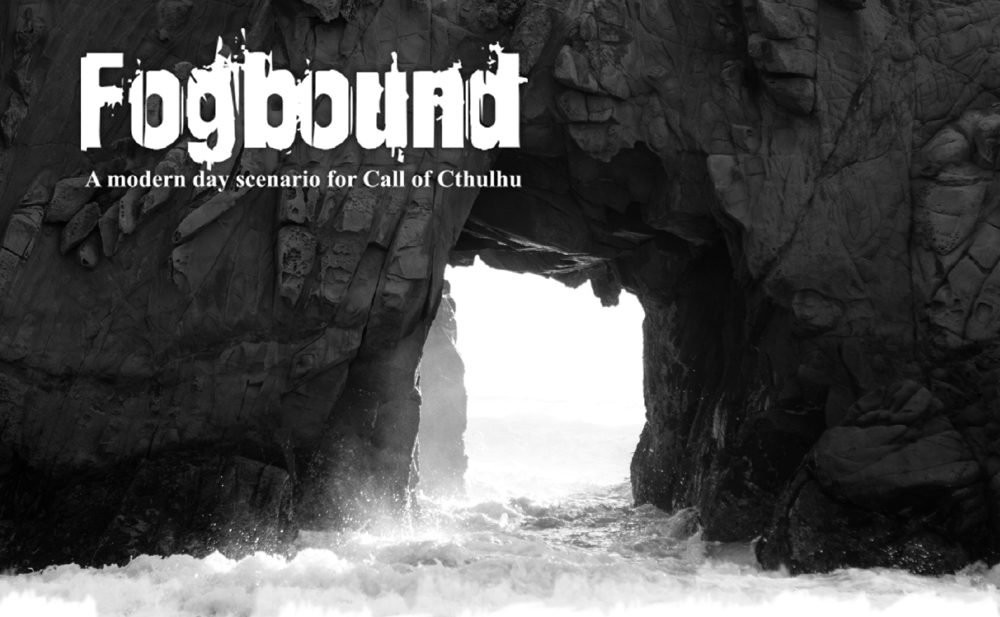

# В плену тумана

*Сценарий для «Зова Ктулху» в наши дни*

## Вступление

Дэниел Кинкейд, бывший взломщик, который теперь пытается жить честно, внезапно исчез. Его брат Стивен подозревает, что исчезновение как-то связано с недавней кражей старинной карты из местного музея и со странной женщиной, с которой Дэниел начал встречаться за несколько недель до кражи. Стивен обращается к друзьям, у которых есть талант расследовать странные происшествия, — к персонажам игроков.

Следуя за Дэниелом, сыщики попадут в сонную деревушку Портхоллоу на корнуолльском побережье. Это тихое живописное местечко с мрачным прошлым, которое до приезда Дэниела десятилетиями оставалось в покое. Теперь же на волю вырвалась древняя тьма, улицы деревни заполнил странный клубящийся морской туман, каждый, кто пытается бежать из деревни, исчезает, а за теми, кто остался, охотятся странные существа.

«В плену тумана» — сценарий для «Зова Ктулху» в наши дни. Он приводит сыщиков в отдалённую корнуолльскую деревню Портхоллоу и сталкивает их со злобной магической силой и с приспешниками самого Ктулху. Сценарий навеян классическими фильмами «Балбесы» (The Goonies) и «Туман» (The Fog), а также серией видеоигр Silent Hill.

Сценарий подходит и для новичков, и для опытных сыщиков. Его можно вести как продолжение прежних сценариев Isolation Games — *Dark Offerings* и *The Wernicke Boxes*, хотя это вовсе не обязательно.

## Сведения для Хранителя

В 1698 году два корабля встретились в бурных водах у берегов Южной Африки. Один из них, «Ставка висельника» (*Hangman’s Wager*), был пиратским судном под командой печально известного капитана «Улыбчивого» Пита Харботтла; другой — странной галерой, ходившей без флага и похожей на что-то из глубокой древности. Завязался бой, и когда Харботтл и его люди взяли галеру на абордаж, они обнаружили, что её команда — уродливые человекоподобные твари, которые бросились на пиратов с дикой яростью, ничуть не заботясь о собственной жизни.

В конце концов пираты победили, хотя и заплатили за это жизнями многих членов команды. Они принялись грабить корабль и пришли в восторг, найдя в трюме странного судна целое состояние в золоте. Среди сокровищ был большой золотой идол чуждого и тревожащего вида. Пираты и не подозревали, что этот идол происходит из циклопических сводов Р’льеха и что он куда больше, чем просто неприятная статуя.

Харботтл и его команда забрали сокровище и отплыли домой — в маленькую деревню Портхоллоу в Корнуолле. Там пираты спрятали добычу в сети контрабандистских туннелей, скрытых в утёсах над деревней. В ту же ночь Харботтл и его люди, охваченные мерзкой силой идола, в кровожадной ярости набросились друг на друга. Из всей команды резни избежал лишь юнга, который бежал, запечатав за собой туннели.
