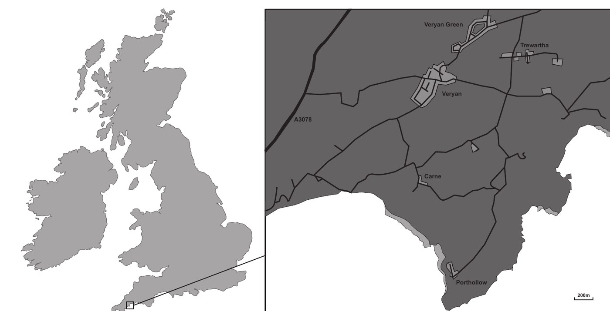

## Портхоллоу на карте

*Подписи на карте: Верьян-Грин (Veryan Green), Треварта (Trewartha), Верьян (Veryan), шоссе A3078, Карн (Carne), Портхоллоу (Porthollow); масштаб — 200 м. Слева — контур Великобритании и Ирландии, рамкой отмечен участок корнуолльского побережья, увеличенный на врезке.*

Юнга, Джон Макгаффри, попытался вернуться домой, в Бристоль. Убегая из туннелей, он успел прихватить карту, показывавшую, как найти потайные туннели и обойти ловушки, а также мешочек странных золотых монет из клада. Монеты он отправил матери, а карту оставил себе в надежде однажды вернуться и забрать остальное золото. По неизвестной причине Джон Макгаффри так и не добрался до Бристоля, и карта исчезла вместе с ним.

В последующие века легенда о спрятанном золоте привлекала в Портхоллоу немногочисленных чудаков-кладоискателей, но ни одному из них не удалось найти вход в туннели Харботтла. В конце концов перестали приезжать и они.

Всё изменилось, когда о идоле и месте, где он покоится, узнала колдунья по имени Андреа Фулчард. Ещё она узнала, что карта, некогда принадлежавшая Джону Макгаффри, каким-то образом оказалась в маленьком музее в Кембридже. Фулчард, последовательница Великого Ктулху, решила найти идола и с его помощью открыть портал в затонувший Р’льех. Для этого она наняла Дэниела Кинкейда, бывшего взломщика, который теперь работал в музее уборщиком, чтобы тот украл карту. Под предлогом поисков пиратского сокровища они вдвоём отправились в Портхоллоу и после нескольких дней исследования пещер нашли путь в пиратские туннели.

Глубоко в туннелях Андреа и Дэниел нашли останки пиратов и сокровище, из-за которого те погибли в схватке. Среди сокровищ стоял идол, и от одного его вида и без того неуравновешенный Дэниел сошёл с ума. Андреа начала заранее подготовленный ритуал: она питает идола силой и медленно открывает магический портал в Р’льех.

Теперь, пробудившись, сила идола вышла за пределы туннелей и дотянулась до деревни Портхоллоу. По мере того как идол набирает силу, стены между мирами рушатся, и между Портхоллоу и Р’льехом начал формироваться портал. С моря наполз неестественный туман и поглотил Портхоллоу, а каждый, кто выходит наружу, таинственно исчезает. По улицам деревни бродят странные силуэты, а оставшиеся жители, перепуганные и отчаявшиеся, прячутся в своих домах.

Всё это случилось за несколько дней до начала сценария. Сыщики оказываются втянуты в происходящее, когда брат Дэниела Кинкейда, Стивен, просит их найти пропавшего брата. Стивен знает, что его брат ввязался во что-то странное, но не понимает, в какую опасность отправляет сыщиков.

## Идол Р’льеха

Идол был создан Ктулху и его сородичами и был одним из десятков идолов, с помощью которых обитатели Р’льеха перемещались в разные точки планеты и обратно. Когда Р’льех погрузился под воду, а за прошедшие с тех пор эпохи произошли многочисленные тектонические сдвиги, большинство других идолов оказались глубоко погребены под землёй или были уничтожены иным образом. Но некоторые уцелели — например, тот, которого Харботтл забрал у жалких человекоподобных тварей в Южной Атлантике.

Сам идол — большой столп высотой около 2,7 м, словно целиком вырезанный из золота. Он выполнен в тревожащем, чуждом стиле и изображает одного из кошмарных головоногих представителей расы Ктулху. Вокруг основания идола вырезаны нечеловеческие фигуры, простёртые ниц в богохульном поклонении. Облик существа кошмарен, и смотреть на идола глубоко тревожно.
