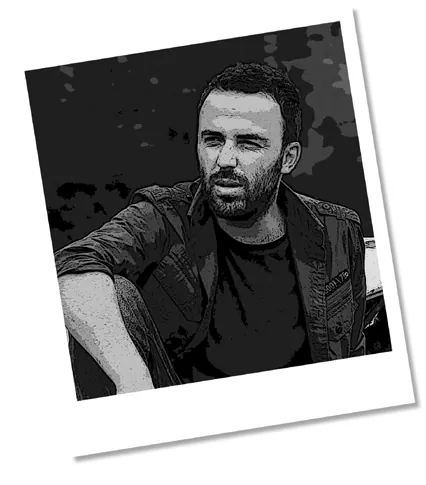
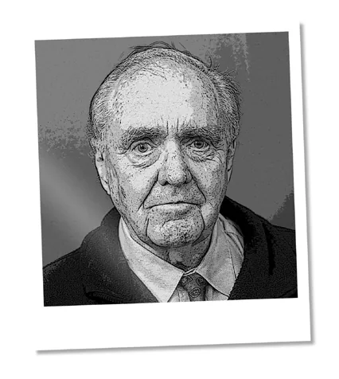

Идол позволяет создать магическую связь между местом, где он стоит, и Р’льехом, давая возможность мгновенно перемещаться в затонувший город и обратно. Прежде чем идолами можно будет пользоваться, их нужно пробудить; это медленный процесс, для которого магическая сила должна перейти от добровольных просителей к золотой статуе.

Когда идол вбирает магическую энергию и начинает пробуждаться, побочным эффектом становится то, что окрестная реальность смешивается с потусторонним измерением, существующим рядом с нашим. Горстка оккультных учёных, побывавших там и выживших, чтобы об этом рассказать, назвала это измерение Вечным берегом. Оно отражает наш мир, но одновременно и Р’льех, сплавляя оба отражения в тревожную смесь.

В этом измерении здания выглядят так, словно их снова и снова заливало разрушительными наводнениями морской воды. Песок и гниющие водоросли лежат кучами на улицах или грудами у стен. Дерево покороблено и гниёт, металл покрыт коркой ржавчины. Густой туман превращает всё, что дальше нескольких метров, в смутные нависающие силуэты. Воздух холодный и пахнет солью и гниющими водорослями, а вдалеке слышен грохот и рёв невидимого океана. Чем глубже путник заходит на Вечный берег, ближе к отражению Р’льеха, тем сильнее меняется архитектура: постройки становятся зелёно-чёрными каменными сооружениями, покрытыми странными рунами, с невозможными углами.

Несмотря на кажущееся запустение, Вечный берег далеко не безжизнен. В тумане бродят странные твари, и заблудившиеся путники вряд ли вернутся в наше измерение. Эти существа, троглодиты, медленно выслеживают каждого, кто забредёт в их владения, и наносят удар под прикрытием клубящегося тумана. Некоторых жертв троглодиты убивают сразу, утоляя свой тёмный голод. Других же эти злобные существа каким-то образом изменяют и отправляют обратно в реальный мир, где те пытаются заманить на Вечный берег новую добычу.

# Действующие лица

Ниже описаны главные персонажи сценария. Во время расследования персонажи игроков могут с ними встретиться. Их характеристики — в главе «Неигровые персонажи».

## Стивен Кинкейд

Именно Стивен Кинкейд вовлекает сыщиков в сценарий: он просит их расследовать исчезновение его брата Дэниела и возможную причастность того к краже карты Макгаффри.

Стивен — писатель, работающий на себя, живёт в Кембридже. Он глубоко привязан к младшему брату, который в семье на положении изгоя. Когда брату после выхода из тюрьмы понадобилась работа, Стивен уговорил свою давнюю подругу Ндиди взять Дэниела уборщиком в свой музей.

Хотя ему очень хочется верить в невиновность Дэниела, Стивен всё больше убеждается, что брат действительно украл карту Макгаффри. Однако он уверен, что Дэниела к этому как-то подтолкнули: выйдя из тюрьмы, тот, казалось, по-настоящему начал новую жизнь.

Стивену под сорок, он среднего роста. Он дружелюбен и приятен в общении, но склонен тревожиться о том, на что не может повлиять.

## Ндиди Удока

Ндиди Удока — владелица и хранительница Музея Удоки, небольшого здания в духе галереи в Кембридже, где выставлены диковинки и предметы искусства. Её жизнь текла спокойно и уютно — до прошлой недели, когда кто-то проник в её музей и украл ничем не примечательную карту XVII века. Ндиди очень хочет вернуть карту: она смутно догадывается, что та может быть не тем, чем кажется.

Ндиди любит собирать диковинки и странные древности, особенно XVII века. Хотя кража карты из музея её расстроила, она более чем готова дать подозреваемому, Дэниелу, второй шанс.

Как историк-любитель, Ндиди не раз натыкалась в старых книгах на странные упоминания, которые убедили её, что в мире есть вещи, недоступные её пониманию.

Высокая элегантная женщина нигерийского происхождения, Ндиди чуть за сорок; она говорит точно и вежливо.

## Закари Уэстленд

Закари — историк на покое, ему под восемьдесят, но в молодые годы он сопровождал своего спутника Реддингтона Уолтон-Брауна во всевозможных приключениях, в том числе в поисках сокровища Портхоллоу. Когда эти поиски трагически закончились исчезновением и предполагаемой гибелью Реддингтона, Закари оставил жизнь искателя приключений и стал учёным, опубликовав несколько книг по истории флота.

Среди вещей, оставленных Реддингтоном Закари, была карта Макгаффри, которую тот в конце концов подарил Музею Удоки. Закари — один из самых знающих специалистов по легендам Портхоллоу и может помочь сыщикам больше узнать о Портхоллоу и связанных с ним легендах.

Закари — невысокий, слегка полноватый старик, но в его глазах блестит огонёк, напоминающий о том пламени, что двигало им в молодости. Он говорит вежливо и дружелюбно, но несколько рассеян.
