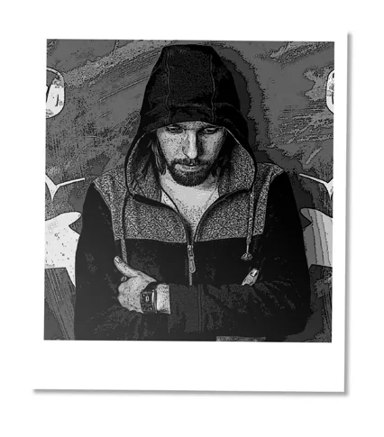
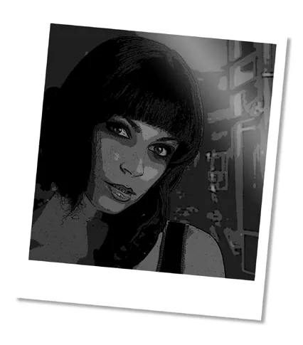

## Чарльз Дуглас

Хозяин паба «Ромовоз» в центре Портхоллоу. Когда-то Чарльз был спокойным, дружелюбным человеком почти без забот. Когда на его деревню опустился странный туман, Чарльз оказался во главе небольшой группы выживших, укрывшихся в его пабе.

Чарльз крепок, надёжен и удивительно собран — если учесть, каким ужасам он подвергся. Им движет яростное желание сберечь пятерых выживших, укрывшихся в его пабе.

Чарльз — высокий, крупный мужчина лет пятидесяти пяти, с седеющими волосами и внушительными усами. Он говорит спокойно и уверенно, но иногда его голос срывается, выдавая пережитую травму.

## Джейн Берроуз

Барменша «Ромовоза» в Портхоллоу и одна из шестерых выживших, укрывшихся в пабе. Джейн — приземлённая, здравомыслящая натура; она цепляется за остатки рассудка, пытаясь найти правдоподобное объяснение странным событиям в деревне. Если ей когда-нибудь придётся в полной мере столкнуться с ужасами, что бродят теперь по деревне, её разум вряд ли это выдержит.

Джейн среднего роста, миловидна, ей лет тридцать пять. Она помогает Чарльзу кормить остальных выживших в пабе, заботиться о них и оберегать их.

## Тим Мёрдок

Тим родился и вырос в Портхоллоу; он рыбак и знает окрестности Портхоллоу как свои пять пальцев. Когда странный туман поглотил его родную деревню, Тим и его жена Салли добрались до местного паба, где и остаются до сих пор.

Тим — высокий мужчина внушительного телосложения, ему чуть за сорок, он лыс и обладает внушительным брюшком. Говорит он на удивление тихо и куда наблюдательнее и вдумчивее, чем кажется поначалу. Тим предан жене и взял на себя роль защитника выживших в пабе.

## Салли Мёрдок

Жена Тима Мёрдока, Салли — глубоко религиозная женщина, убеждённая, что странные события в Портхоллоу — дело рук «демонов». Из всех выживших в пабе Салли легче всех принимает сверхъестественную природу происходящего.

Салли чуть за сорок; она честная, приветливая женщина с каштановыми волосами и добрыми манерами. Потрясения последних дней сделали её ещё более зависимой от веры, и в минуты тревоги она сжимает серебряный крестик на цепочке.

## Луис Прачет

Луис отдыхал в Портхоллоу с женой Самантой и сыном Джеймсом и до смерти напуган странным поворотом событий последних дней. Ему с сыном удалось добраться до относительно безопасного паба «Ромовоз», когда появился туман, но жена Луиса отстала от них и пропала.

Теперь Луис целыми днями тревожится о Саманте и пытается успокоить сына. Он совершенно растерян и держится за рассудок только благодаря другим выжившим.

Луису лет тридцать пять, он среднего роста, с растрёпанными чёрными волосами. Он вздрагивает от малейшего звука, но старается сохранять спокойствие ради сына.

## Джеймс Прачет

Тринадцатилетний сын Луиса и Саманты, Джеймс глубоко встревожен исчезновением матери и ухудшающимся душевным состоянием отца. Хуже того, Джеймс уверен, что несколько раз по ночам видел, как мать заглядывает в окна «Ромовоза».

Джеймс среднего роста, с такими же тёмными волосами, как у отца. События последних дней сделали его тихим и замкнутым, и теперь он сильно боится незнакомцев.

*Прим. перев.: в оригинале здесь и на с. 16 и 18 — «Samatha»; имя — Саманта (Samantha).*

## Малкольм Имз

Малкольм — приходской священник Портхоллоу, оказавшийся в ловушке в деревне, когда опустился туман. Он полностью сломлен: его затянуло на Вечный берег, и ему удалось найти дорогу обратно. Теперь он до ужаса боится темноты и прячется в своей церкви, где включил весь свет, какой смог найти.

Малкольму лет тридцать пять, он худощав и носит яркий свитер с традиционным англиканским пасторским воротничком, указывающим на его сан.

## Дэниел Кинкейд

Младший брат Стивена, бывший взломщик, пытающийся жить честно. Ещё несколько недель назад ему удавалось строить новую жизнь, пока соблазнительная колдунья Андреа Фулчард не втянула его обратно в преступление. Украв для неё карту Макгаффри, Дэниел отправился с Андреа в деревню Портхоллоу, уверенный, что она лишь ищет богатства — потерянное пиратское сокровище. К тому времени, как сыщики встретят его, Дэниел почти полностью обезумел от соприкосновения с идолом.

Дэниел — атлетически сложённый мужчина под тридцать, с растрёпанными каштановыми волосами и быстрой улыбкой. Когда сыщики встретят его, ужасы последних дней сделают его бледным и измождённым.

*Прим. перев.: в оригинале здесь (и в статблоке на с. 24) фамилия напечатана «Fuchard»; везде в остальном тексте — «Fulchard» (Фулчард).*

## Андреа Фулчард

Андреа — колдунья и последовательница самого Великого Ктулху. Несколько лет она искала Идол Р’льеха и недавно обнаружила указания на то, что карта Макгаффри показывает место, где он покоится. Поняв, что карту придётся украсть из Музея Удоки, Андреа соблазнила Дэниела и привлекла его к делу, сказав, что ищет пиратское сокровище и поделится с ним. Внешне милая и скромная, она — опасная и совершенно злая особа.
