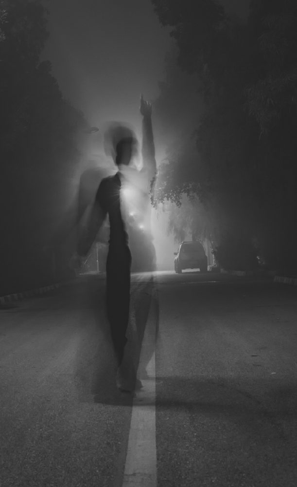

### Въезд в Портхоллоу

Когда сыщики прибудут в Корнуолл и поедут в Портхоллоу, Хранителю советуем описывать погоду как серую и холодную, с морским туманом, льнущим к побережью. Это, надеемся, объяснит, почему сыщики не замечают, как проезжают сквозь сверхъестественную стену тумана, окружающую Портхоллоу.

Въехать в Портхоллоу достаточно легко. Обманчиво легко. Деревню окружает густой туман, и вести машину немного трудно, но в определённое время года это не редкость. Разве что сейчас для тумана не совсем сезон. Сыщики и не подозревают, что, въезжая в Портхоллоу, пересекают невидимую преграду, отделяющую деревню от остальной реальности. Пока с Идолом Р’льеха не будет покончено, это путь в один конец. Каждый, кто попытается покинуть Портхоллоу, на машине или пешком, вернётся туда, откуда начал. Он проедет или пройдёт сквозь густой, застилающий глаза туман и вдруг обнаружит, что снова въезжает в Портхоллоу по той же дороге, по которой уезжал.

Въехав в Портхоллоу, сыщики должны быстро понять, что с деревней творится что-то очень странное. Окутанные туманом улицы пусты; машины стоят так, будто их бросили, а двери многих домов качаются на ветру нараспашку.

### Предлагаемая сцена: добро пожаловать в Портхоллоу

Эта сцена может произойти вскоре после того, как сыщики впервые прибудут в Портхоллоу. Лучше всего — сразу после того, как они впервые остановят машину и выйдут осмотреться.

Прочитайте или перескажите своими словами:

> *«Вглядываясь в клубящийся вокруг густой туман, вы замечаете, что кто-то, шатаясь, бредёт по дороге в вашу сторону. В метре от вас из тумана, пошатываясь, выходит мужчина — с безумным взглядом, растрёпанный, сжимающий большой кухонный нож; ему явно очень плохо. Увидев вас, он кричит: „Вам не сбежать! Оно не отпустит! Дорога просто привела обратно сюда, обратно к морю! Оно зовёт меня, слышите? ВЫ СЛЫШИТЕ?! Я НЕ ДАМ ЕМУ МЕНЯ ЗАБРАТЬ!“ С этим последним выкриком мужчина вскидывает нож и перерезает себе горло, падая перед вами в быстро растекающуюся лужу крови».*

Сыщики, ставшие свидетелями смерти этого человека, должны пройти **проверку Рассудка** (потеря 0/1d6 Рассудка).

Эта сцена должна потрясти сыщиков и показать им, что в деревне творится что-то совсем неладное. Конечно, сыщики могут успеть остановить мужчину, прежде чем тот себя поранит, или даже спасти его после того, как он перерезал себе горло. Если так случится, мужчина (его зовут Говард Энис) мало что сможет им рассказать: он совершенно безумен, почти всё время бредит о том, что его зовёт море, и снова и снова будет пытаться покончить с собой.

### Предлагаемая сцена: выхода нет

Эта сцена должна произойти, если сыщики в какой-то момент решат попытаться покинуть Портхоллоу. Пешком ли, на машине ли (или даже на лодке по морю) — туман, окружающий Портхоллоу, собьёт сыщиков с пути и развернёт обратно, не давая им сбежать.

Прочитайте или перескажите своими словами:

> *«Вы едете по единственной дороге, ведущей из Портхоллоу, и клубящийся туман быстро смыкается вокруг вас. Неизвестно сколько времени вы едете в странном молочно-белом пузыре: туман глушит все звуки, и вы видите лишь на метр вокруг себя. Вдруг впереди возникает знак. На нём написано: „Добро пожаловать в Портхоллоу, пожалуйста, ведите машину осторожно“. С ужасом вы понимаете, что каким-то образом повернули назад: вы снова в деревне».*

В первый раз, когда это случится, сыщики должны пройти **проверку Рассудка** (потеря 0/1d2 Рассудка) — из-за полной странности происходящего.

### Портхоллоу сейчас

К началу сценария деревня уже попала под влияние растущей силы Идола Р’льеха. Когда сыщики действительно доберутся до Портхоллоу, пройдёт по меньшей мере несколько дней, если не больше, с тех пор как странный туман наполз с моря и поглотил деревню.

Большинство жителей Портхоллоу теперь пропали: их поглотил туман и перенёс на Вечный берег, где их ждал ужасный конец. Другие сошли с ума и либо покончили с собой, либо ушли в море, бормоча о чём-то, что зовёт их в глубины.

Немногие оставшиеся в деревне люди глубоко потрясены, они лишились значительной части рассудка, и многие временно или даже навсегда безумны. Небольшая группа выживших собралась в местном пабе, чтобы защищаться вместе (подробнее об этой группе — в разделе «Паб „Ромовоз“»). Местный викарий, Малкольм Имз, прячется в часовне на склоне холма.
