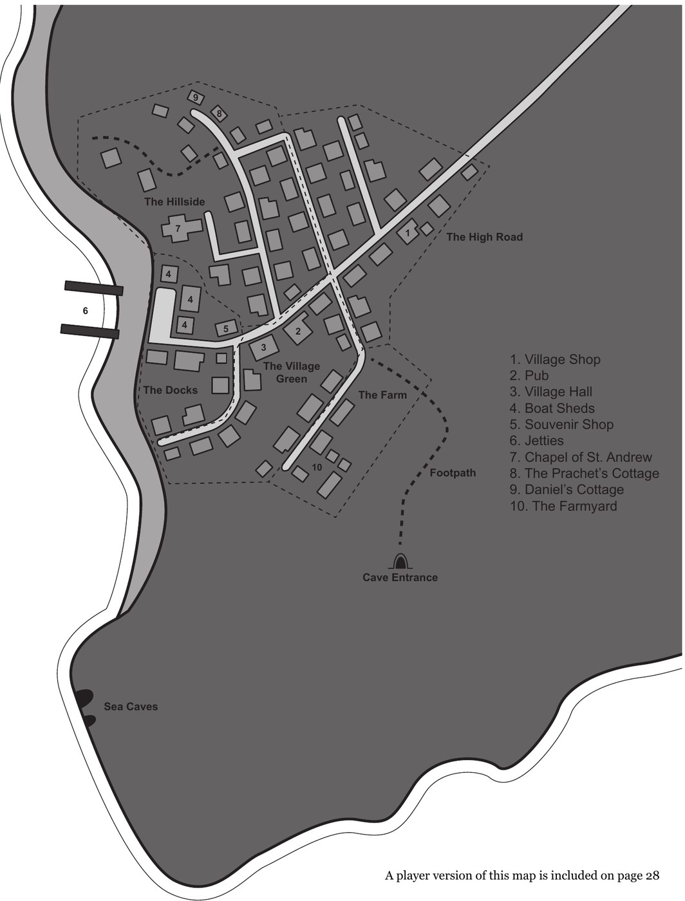

## Карта Портхоллоу

*Районы на карте: Склон холма (The Hillside), Главная дорога (The High Road), Деревенский луг (The Village Green), Пристань (The Docks), Ферма (The Farm); тропа (Footpath), вход в пещеры (Cave Entrance), морские пещеры (Sea Caves).*

| № | Место |
|---|---|
| 1 | Деревенский магазин |
| 2 | Паб |
| 3 | Деревенский клуб |
| 4 | Лодочные сараи |
| 5 | Сувенирная лавка |
| 6 | Причалы |
| 7 | Часовня Святого Андрея |
| 8 | Коттедж Прачетов |
| 9 | Коттедж Дэниела |
| 10 | Фермерский двор |

*Подпись под картой: «Версия этой карты для игроков приведена на с. 28».*
